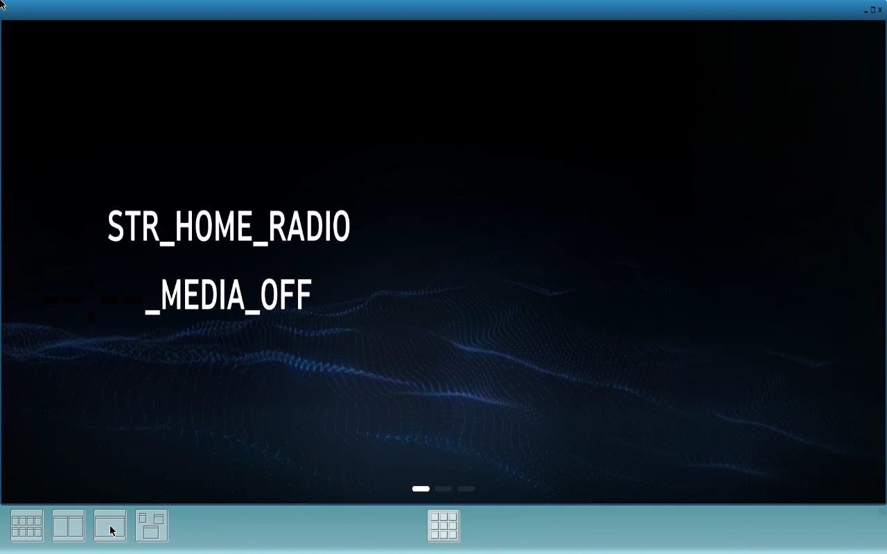
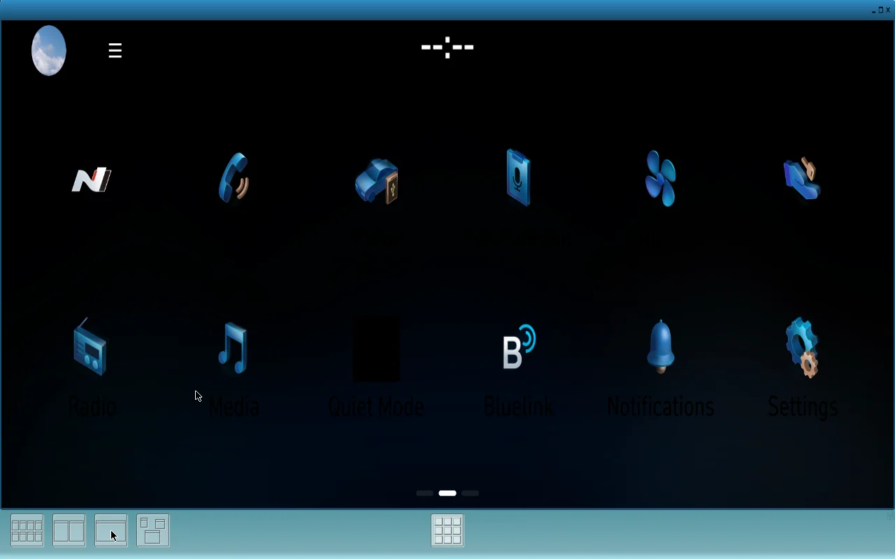
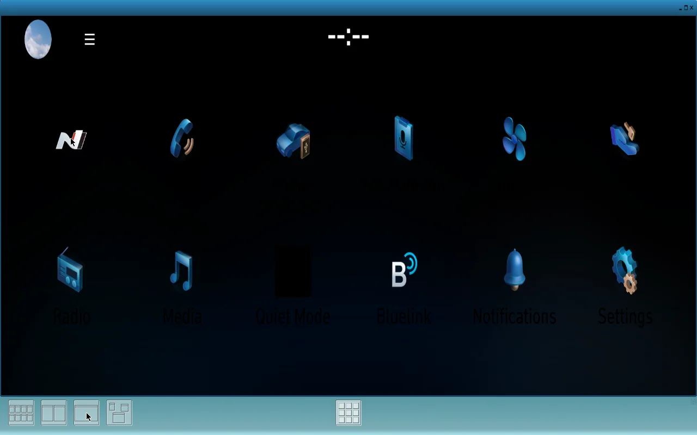

# Hyundai i20 N Infotainment Lab

**Independent, community-driven reverse engineering and offline emulation research.**  
**Status:** experimental — OEM `AppHomeScreen` **renders at fullscreen and has now been navigated from page 0 to page 1 in a controlled private test**; launching the other original applications and reproducing a complete HMI remain unresolved.

We are studying how selected software components from a Hyundai i20 N infotainment environment work, with the long-term goal of reproducible offline testing and UI-customization research. The private test lab uses QEMU, Linux, Weston/Wayland IVI, EGL and original Qt 5.4.1 components.

> **This is not a downloadable OEM emulator, firmware mod, unlock tool or vehicle flashing kit.** No original Hyundai firmware, binaries, extracted QML, textures, maps or other proprietary assets are distributed here.

## Research progress (30 October 2026; privately reported tests)

| Component | Status |
| --- | --- |
| Isolated QEMU Linux guest and graphics | Running in the private lab |
| Weston + Wayland IVI | Running |
| OEM Qt 5.4.1 `qmlscene` rendering a **minimal laboratory QML scene** | **Verified** via pixel checks, 14 frame callbacks, Wayland `attach` and `commit` |
| OEM `AppHomeScreen` | Partial original UI rendered; later fullscreen test reported stable snapshots at 110s and 170s (929,959 differing pixels versus reference Weston desktop) |
| SocketCAN startup dependency | Identified; compatible modules allowed isolated startup to progress without any CAN traffic |
| Original Home navigation | **Page 0 → 1 transition reported** after corrected pointer drag via a separate lab-built IVI controller; corroborated by original QML event and screenshot |
| Home icon / app launch | **Original Home + OEM ApplicationManager now coexisted for 10 minutes** in one isolated laboratory profile. Home navigates and sends `appid=500` to the original manager, which replies **255**; no other application opens yet |
| Graphics blockers | Earlier Pixman/GL/scale issues were bypassed **in the new coexistence profile**: Home displays at **1280 × 730** without watchdog or Pixman assertion for 10 minutes. The manager uses a **separate SysV IPC namespace**, not full OEM IPC. ASTC and localization remain incomplete |
| Private D-Bus services | Codex reports 47 distinct calls parsed from outgoing headers, including 12 appmanager registrations and 104 MICOM requests; responses not fabricated |

**Latest checkpoint (30 October 2026, owner's private Codex status at 19:22 UTC):** the original **Home and ApplicationManager ran together for 10 minutes** with Weston GL and OEM IVI window manager (run `20261030T175729Z-3869-1`). Home appeared at **1280 × 730** in both five- and ten-minute captures, without Pixman assertions or Home watchdog termination. Codex isolated ApplicationManager in a **separate SysV IPC namespace** after tracing the watchdog stall to the `MICOMSTATUSMESSAGE` semaphore; this is an experimental workaround, **not full OEM IPC integration**. Original Home navigated to page 1 and sent `appid=500` to the real manager in other runs, but the manager returned **255**. Original **AppSetup connected to Wayland and created IVI surface 1001** after a reference UI ID-remapping experiment; it **did not attach a buffer or render**. An **AppStandbyClock** trial was still underway when the report was written. **No secondary original application has yet been demonstrated running visibly or interactively.** See the [new IPC and application trials report](docs/PROGRESS-2026-10-30-IPC-APPS.md), which summarizes owner-provided reports rather than independently replayed VM evidence.

Details: [Research status](docs/STATUS.md) · [Latest IPC/app trials](docs/PROGRESS-2026-10-30-IPC-APPS.md) · [Earlier GL/WM investigation](docs/PROGRESS-2026-10-30-GL-INTEGRATION.md) · [30 October progress log](docs/PROGRESS-2026-10-30.md) · [29 October progress log](docs/PROGRESS-2026-10-29.md) · [AI-agent handoff](docs/AI-HANDOFF.md) · [Roadmap](docs/ROADMAP.md) · [Architecture notes](docs/ARCHITECTURE.md)

## Screenshots from the private QEMU lab (30 October 2026)

These **owner-supplied screenshots** show the original Hyundai Home application running inside a disposable QEMU/Weston guest. They document visible test results, **not** a finished emulator or verified launch of N Mode or other applications.

| Home inicial (110 s) | Segunda página original | Pulsación en icono N |
| :---: | :---: | :---: |
|  |  |  |
| Initial fullscreen Home (untranslated labels remain) | Original menu page 1 reached after a pointer drag | Click routed to original Home; later Codex logs identify `appid=500` and a missing appmanager service |

The 170-second capture supplied by the owner duplicates the page-1 frame, so it is not stored a second time. Images are optimized WebP versions of the supplied captures; no original firmware, extracted textures, binaries, or QML are provided. Hyundai GUI visuals and trademarks remain the property of their owners and are **not relicensed** by this project's MIT license.

## Using another coding agent

This project provides [CLAUDE.md](CLAUDE.md) for Claude Code, [AGENTS.md](AGENTS.md) for other agents, and a shared [AI handoff](docs/AI-HANDOFF.md). These public documents describe the research but **do not** contain the private VM or proprietary input files.

## Where the community can help

- Qt 5.4.1 / QML and Wayland IVI surface visibility and layering
- Linux graphics / EGL / Mesa software rendering
- ASTC texture handling with legally shareable synthetic test assets
- Hyundai/Kia software architecture documentation **without posting OEM files**
- Reproducible offline experiments, original Python/Bash tooling and tests

See [open Issues](../../issues), [contributing guidelines](CONTRIBUTING.md), and [security guidance](SECURITY.md). We encourage small, well-evidenced pull requests. Please mark findings as **runtime verified**, **static analysis**, or **hypothesis**.

## Publication rules

Do **not** submit original firmware, root filesystems, executable binaries, proprietary QML, Hyundai textures, map data, keys, personal identifiers, full core dumps or raw vehicle logs. Do not upload private laboratory directories or VM disk images. Use a clean public working tree, not the private lab checkout.

This research is designed for **offline, isolated software experiments**. The repository does not support CAN injection, interactions with a running vehicle, bypassing vehicle security, or flashing physical head units.

## Licensing and disclaimer

Original code and documentation contributed to this repository are available under the [MIT License](LICENSE), where contributors have the right to license them. The license **does not apply** to Hyundai/Kia or other third-party proprietary works.

This is an unofficial independent project. It is not affiliated with or endorsed by Hyundai Motor Company, Kia or their suppliers. Product names and trademarks belong to their owners.

## Acknowledgements and upstream research

This project has benefited from publicly shared research and materials from the following independent projects. **Thank you to their maintainers and contributors:**

- **[Hyundai/Kia Gen5W navigation firmware research — laralbir](https://github.com/laralbir/hyundai-kia-gen5w-navi-firmware)**: useful reference for studying Gen5W firmware structure and related research.
- **[HKG Gen5W ReverseEngineer — cantcs](https://github.com/cantcs/HKG_Gen5W_ReverseEngineer)**: useful reference for reverse-engineering workflows and Hyundai/Kia Gen5W investigations.

We acknowledge their prior work and ideas. This repository is **not a fork** and does not claim their work as its own. The precise file-level provenance of any adapted scripts or code is still being audited: **do not publish copied upstream code until its origin, license and required notices are verified**. See [PROVENANCE.md](PROVENANCE.md) for the attribution checklist. The platforms researched by these projects may differ from the i20 N BC3N variant.

