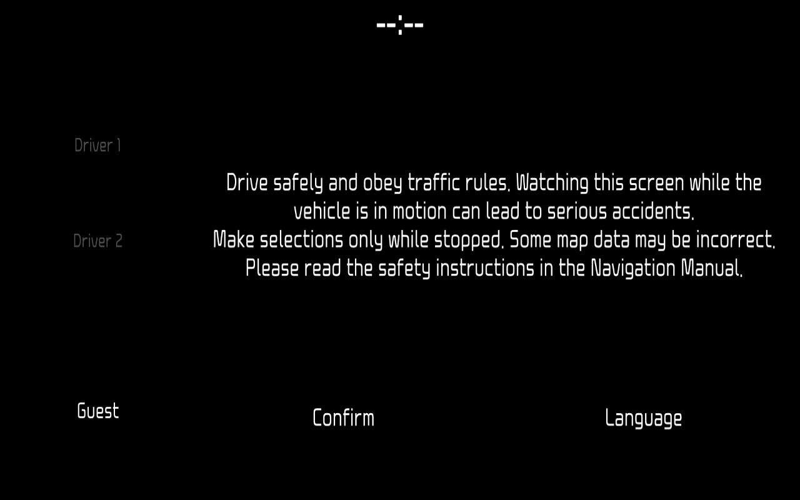
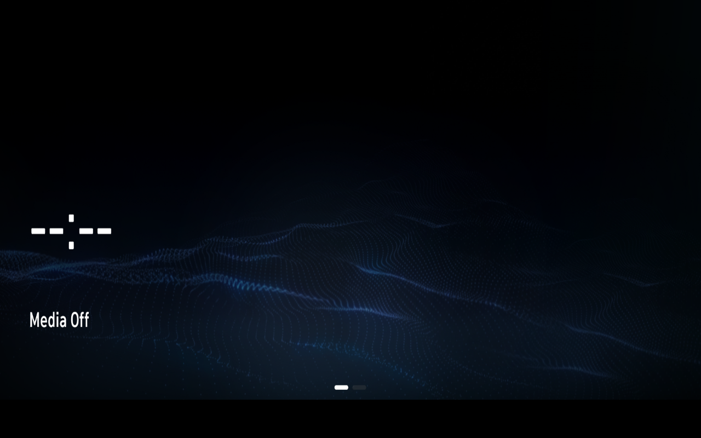
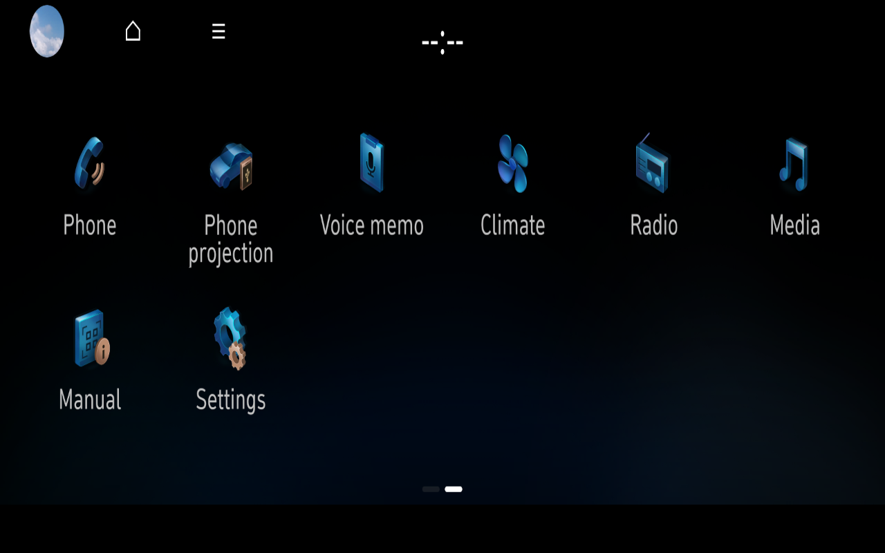
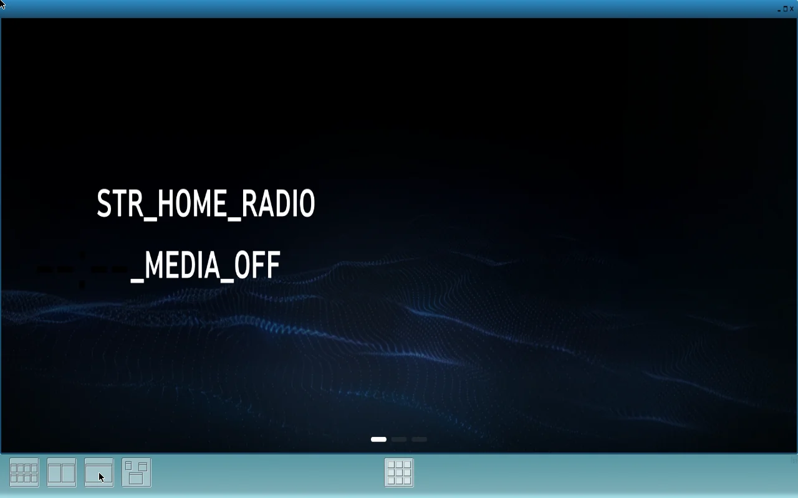
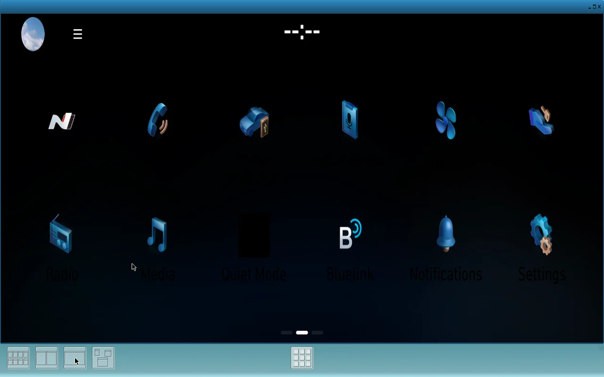
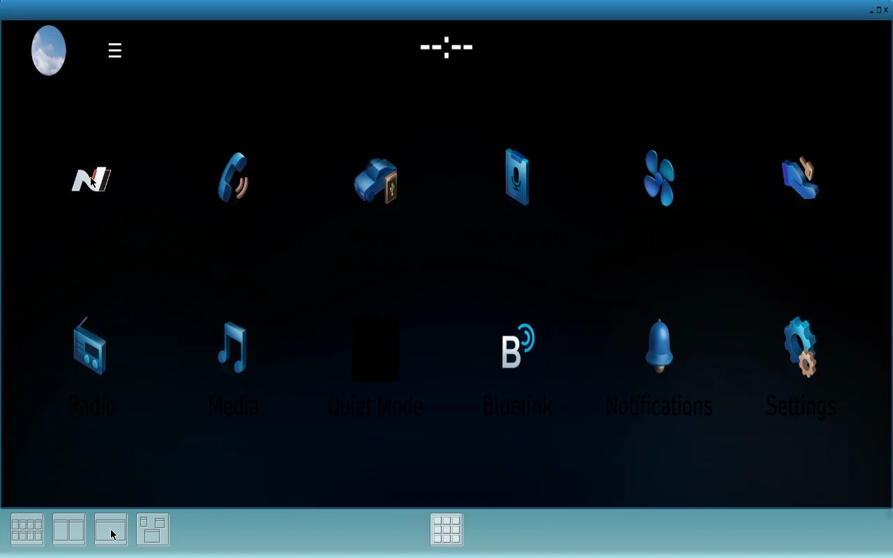

Latest verified checkpoint, 7 November 2026: [Original N Mode Track, MY23 scope and expanded audit](docs/PROGRESS-2026-11-07-NMODE-MY23-TEXTURES-AUDIT.md). Owner target is BC3N i20 N **MY23 Spain/Europe**, software updated in 2025; not BC3N25MY. Original nm2/pf0 Track pages, VNC interaction, aligned Home return and further Home navigation are verified in a separate offline profile. Sixty-six further decoded textures have 132 matching base-source hashes and pixel roundtrips; one empty pair is excluded. Full OEM vehicle identity remains unverified (existing CarType fixture 0/LX2). Media provider startup is unblocked in an explicit temporary OEM-library runtime profile; its GUI remains unverified. Thirty-five Launcher / 154 manager metadata entries are inventoried, with unsafe routes excluded. Earlier entries below are historical where superseded.

Latest verified checkpoint, 7 November 2026: [Original integrated N Mode UI and application audit](docs/PROGRESS-2026-11-07-NMODE-APP-AUDIT.md). Original Spanish N Mode500 displayed through the original manager/launcher, accepted VNC interaction and returned to aligned navigable Home. This is a partial legacy UI milestone with explicit local capability configuration,21 decoded original textures and unavailable sensor data; exact BC3N/nm2 fidelity remains pending. The separate stable Home/Radio profile is preserved. A35-entry static inventory and bounded offline application audit distinguish metadata, visible functionality and exclusions.

Latest verified checkpoint, 7 November 2026: [Radio viewport, VNC return and optional Windows export](docs/PROGRESS-2026-11-07-RADIO-VIEWPORT-EXPORT.md). A new offline overlay verified a fitted original Radio reopen, aligned Home return and further VNC page navigation with the original processes retained. Windows screenshot export failures now remain locally recorded secondary-copy failures. Station List after reopening and slow presentation remain pending; the previous software/stability profile and default launcher are unchanged. No new ten-minute stability test was run.

Earlier verified checkpoint, 7 November 2026: [Spanish original cycle and bounded post-cycle stability](docs/PROGRESS-2026-11-07-SPANISH-STABILITY.md). Original Confirm→Home→Radio→Home completed, followed by 658.75s of monitoring and five further native Home page changes. All six original process identities were retained; eleven checked Home images match their complete page references. Guest shutdown was clean. A Windows operator launcher has started a separate overlay and remains under validation. This is an offline UI milestone, not a completed emulator or proof of RF/audio/navigation/GPU functionality.

# Hyundai i20 N Infotainment Lab

**Independent, community-driven reverse engineering and offline emulation research.**  
**Status:** experimental. Original Spanish Confirm/Home/Radio/Home and bounded post-cycle Home stability are verified in separate trials. Reopening Radio now fits the laboratory output and returns to aligned, VNC-navigable Home in one new trial. Station List after reopening, presentation latency, the final Windows launcher, audio and remaining applications are still pending. OEM material stays private.

**Latest (6 November):** [Radio artwork, Spanish catalogs and remaining watchdog](docs/PROGRESS-2026-11-06-RADIO-TEXTURES-SPANISH.md).

**Earlier (6 November):** [Home alignment, animation timing and input validation](docs/PROGRESS-2026-11-06-HOME-ALIGNMENT.md).

**Previous:** [Home to European Radio and authentic Home return](docs/PROGRESS-2026-11-01-HOME-TO-EURADIO.md). The current European Home sends appid77/reason38; earlier appid70/reason32 requests belong to other configurations. [Hidden Home diagnosis and input evidence](docs/PROGRESS-2026-11-01-HIDDEN-HOME.md) explains the preceding callback stalls and measured genuine Ping replies.

We are studying how selected software components from a Hyundai i20 N infotainment environment work, with the long-term goal of reproducible offline testing and UI-customization research. The private test lab uses QEMU, Linux, Weston/Wayland IVI, EGL and original Qt 5.4.1 components.

> **This is not a downloadable OEM emulator, firmware mod, unlock tool or vehicle flashing kit.** No original Hyundai firmware, binaries, extracted QML, textures, maps or other proprietary assets are distributed here.

## Research progress (1 November 2026; privately observed tests)

| Component | Status |
| --- | --- |
| Isolated QEMU Linux guest and graphics | Running in the private lab |
| Weston + Wayland IVI | Running |
| OEM Qt 5.4.1 `qmlscene` rendering a **minimal laboratory QML scene** | **Verified** via pixel checks, 14 frame callbacks, Wayland `attach` and `commit` |
| OEM `AppHomeScreen` | Original fullscreen Home at **1280 × 730**; navigation **0 → 1 → 0 while original ApplicationManager is running** (run `20261031T163512Z-9562-1`); independent original N Mode request still returns **255** |
| SocketCAN startup dependency | Identified; compatible modules allowed isolated startup to progress without any CAN traffic |
| Original Home navigation | **Page 0 → 1 transition reported** after corrected pointer drag via a separate lab-built IVI controller; corroborated by original QML event and screenshot |
| Original AppLauncher and application transitions | **Original reduced-list AppLauncher starts original ApplicationManager, Home and Standby** with isolated environment/timing workarounds. Genuine Standby Confirm-driven Home return and **interactive Home after return** demonstrated in `20261101T095842Z-17749-1` with experimental 45 s timer extension and compositor foreground repair; **not yet reliable at original timings** |
| Rendering and stability | **Fullscreen** Weston controller fixed old **320 × 365** tiling; multiple OEM processes have coexisted for ten guest minutes. A **lab-only Wayland frame-callback rescue** prevented Home's hidden-surface watchdog in bounded trials; Mesa **llvmpipe on Home only** avoided manager `AppKill` in later bounded foreground transitions. Manager IPC namespace remains isolated; no production-grade integration |
| Private D-Bus services | Original services/routes examined, including Clock `show_window_fg` and real **UserProfileManager**. Synthetic service compatibility is a **future research direction**, not a completed implementation |
| Original MICOM power initialization | Earlier 1 November OEM MICOM + synthetic QEMU-UART `AskSysBootinfo` test produced a **genuine MICOM→manager D-Bus response** and **`power_status=16`**. Later launcher-controlled Home/Standby tests form a **separate experimental profile**; do not assume those runs shared the same MICOM setup |
| Original secondary UI, Settings and Radio | **Standby** renders original Confirm/Language; a one-click, trace-proven original Confirm handler requests return to Home. Original **Settings** is an internal Home QML submenu, navigable back to original Home page1 in separate runs. Original **Radio** icon invokes authentic `appid=70, reason=32` request, AppEURadio77 now launches, registers and shows FM with a labelled synthetic European boot-info input; interactive operation and stable coexistence remain pending. Original EngineerMode only rendered its title in an earlier trial |

**Earlier checkpoint (1 November 2026, owner-supplied status at 10:19 UTC):** **Original AppLauncher, original manager, original Standby and original Home** can run together in a bounded private QEMU test, after preventing inherited double `QT_WAYLAND_SHELL_INTEGRATION=ivi:ivi` selection and selectively lengthening launcher startup timeouts. In `20261101T095204Z-16827-1` and **`20261101T095842Z-17749-1`**, the original Standby Confirm click—not its separate **automatic original 10 s QTimer path**—emitted the **first and only real OEM request `(304,2,12,1,0)`** after a targeted **10→45 s QTimer extension** in a reversible, private preload probe. Manager reached **standby12/drawn Home11**; the initial Home rendering was partial, but a genuine drag subsequently displayed the **original Home second page with all its icons**. An experimental Weston foreground-surface repair is also involved. **Separate** integrated runs showed original **Home Settings submenu → original Home** round-trip. The latest Radio icon test `20261101T101301Z-27925-1` proved original QML and D-Bus request **`(304,70,32,1,0)`**, but **AppEURadio was not running, manager still drew Home11, and the Radio app did not open**. **Do not treat reply 255 alone as success or failure.** This is a controlled lab achievement, **not** a reliable turnkey OEM emulator. See [the detailed 1 November Confirm/AppLauncher/Radio report](docs/PROGRESS-2026-11-01-HOME-CONFIRM-LAUNCHER-RADIO.md).

**Previous checkpoint (1 November 2026, owner-supplied status at 01:58 UTC):** Original MICOM successfully reached its authentic system D-Bus identity using **a second virtual QEMU UART** (the earlier `/dev/ttyS1` ioctls failed on a missing/invalid UART). In controlled run `20261101T015448Z-28405-1`, a **single synthetic virtual-hardware reply** to original **`AskSysBootinfo`** (response identifier `0x8201` and power byte `2` identified through original executable analysis; all other packet fields synthetic zeros) was processed by the **original MICOM**, which sent a **real D-Bus reply** accepted by original **ApplicationManager** (`reply is VALID`). Manager **`power_status` changed from `1` to `16`**, and its original getter returned 16; original Home rendered fullscreen at 110 seconds. A prior direct `NotifyMonitorPowerEvent(16)` call **did not** change power status. **Not yet demonstrated:** whether the manager's internal **`currentStandbyStatus` changes from 10 to 11** or whether Standby returns to Home. Combined Home+manager+Standby+MICOM test `20261101T015819Z-13437-1` was **in progress at this cutoff**. See [1 November MICOM/power report](docs/PROGRESS-2026-11-01-MICOM-POWER-STATE.md).

**Previous checkpoint (31 October 2026, owner-supplied status at 16:43 UTC):** genuine OEM **Home navigation 0→1→0** is logged **with ApplicationManager running** in `20261031T163512Z-9562-1`. Original **Standby/Clock** becomes foreground and the Confirm/Language form is visible with **`enableBtn=1`**. An earlier controlled run `20261031T132500Z-6658-1` proved the **original Confirm button's pressed/released/btnClicked signals** (`P=R=C=1`) and delivery of a genuine **appid 2 / reason 12** request. **Manager still rejects return**, retaining **`currentStandbyStatus[10]`**. The direct GoHome event `322` returned **255**; neither it nor re-requesting Standby reason 11 is a valid fix. A separate lab **HMI Wayland callback rescue** and **Mesa llvmpipe on Home only** allowed foreground transitions **without Home watchdog or AppKill** in bounded runs, but are **experimental workarounds**. The last test stopped at its programmed **600s limit (`home-exit=124`)**; its final `home_rendered=false` flag must not be mistaken for proof that Home never rendered or for a successful Home return. **A full interactive Home → Standby → Home cycle is not working yet.** Detailed findings: [31 October foreground/return integration report](docs/PROGRESS-2026-10-31-HOME-STANDBY-INTEGRATION.md).

Details: [Research status](docs/STATUS.md) · [Latest: 1 Nov Confirm, AppLauncher, Settings and Radio](docs/PROGRESS-2026-11-01-HOME-CONFIRM-LAUNCHER-RADIO.md) · [Earlier 1 Nov MICOM and power status](docs/PROGRESS-2026-11-01-MICOM-POWER-STATE.md) · [31 Oct Home/Standby integration](docs/PROGRESS-2026-10-31-HOME-STANDBY-INTEGRATION.md) · [Earlier 31 Oct app experiments](docs/PROGRESS-2026-10-31-OEM-APPS.md) · [Earlier IPC/app trials](docs/PROGRESS-2026-10-30-IPC-APPS.md) · [Earlier GL/WM investigation](docs/PROGRESS-2026-10-30-GL-INTEGRATION.md) · [30 October progress log](docs/PROGRESS-2026-10-30.md) · [29 October progress log](docs/PROGRESS-2026-10-29.md) · [AI-agent handoff](docs/AI-HANDOFF.md) · [Roadmap](docs/ROADMAP.md) · [Architecture notes](docs/ARCHITECTURE.md)

## Obtain the firmware legally (not hosted here)

**Official Hyundai Europe / Spain navigation and infotainment update portal:** [Hyundai update site](https://update.hyundai.com/EU/ES/home). Owners can [search by model or VIN](https://update.hyundai.com/EU/ES/search) and select **i20 N**; verify the exact **BC3N** variant and software version before obtaining any update. The July 2026 official version list included **`BC3N.EUR.S5W_L.001.001.260128`**, but availability and compatibility can change.

**This repository contains no original Hyundai firmware, decrypted OEM files, maps or map databases.** Each researcher is responsible for obtaining suitable materials independently and respecting applicable terms. See [firmware sources, compatibility notes and publishing rules](docs/FIRMWARE-SOURCE.md).

The original vehicle may depend on **GPS/GNSS, cellular modem/SIM, online services, MICOM, and vehicle networks**. In our isolated QEMU lab, missing inputs may be supplied through **clearly disclosed, deterministic synthetic test adapters**; they are not real vehicle readings or a full replacement for Hyundai navigation or connected services.

## Tools to inspect your own update (no OEM data included)

To reproduce **read-only firmware examination**, see [firmware analysis toolchain, third-party decryptor references and source-provenance notes](docs/TOOLS-AND-LOCAL-EXTRACTION.md).

This repository now provides an [original offline inventory scanner](tools/firmware_inventory.py) (with [synthetic-only tests](tests/test_firmware_inventory.py)) to identify file/container headers, basic ELF architectures, sizes and optional SHA-256 hashes. It **does not decrypt, extract, patch or publish firmware**. Obtain a compatible European i20 N update independently from Hyundai; see the [official source](docs/FIRMWARE-SOURCE.md).

**Not claimed:** successful decryption or boot of the unchanged Hyundai OEM **kernel**. Our private reports verify running selected **OEM userspace** components in a compatible QEMU Linux environment; that is not equivalent to running the exact original head-unit kernel. The specific local `update_decryptor` build and private wrappers have not yet been audited/exported to the public repository.

## New: original Confirm → navigable Home screenshot sequence (1 November 2026)

**Three owner-approved screenshots from the same private run `20261101T095842Z-17749-1`.** The sequence is not proof of unmodified OEM boot timing: this controlled test used a **reversible Standby QTimer extension (10 → 45 seconds)** and experimental Weston Home foreground repair. The screenshot at +55 seconds is **partially rendered**; a later genuine pointer drag reached the complete original Home second page.

| OEM Standby / Confirm screen | Original Home after return (+55 s, partial frame) | Original Home navigable after drag (complete page 1) |
| :---: | :---: | :---: |
|  |  |  |

**Important:** the first screenshot is the Standby/Confirm visual state in the logged sequence; the original request and input-event provenance are established by the separate private run logs, **not by screenshots alone**. See [technical investigation and timing caveats](docs/PROGRESS-2026-11-01-HOME-CONFIRM-LAUNCHER-RADIO.md).

## Screenshots from the private QEMU lab (30 October 2026)

These **owner-supplied screenshots** show the original Hyundai Home application running inside a disposable QEMU/Weston guest. They document visible test results, **not** a finished emulator or verified launch of N Mode or other applications.

| Home inicial (110 s) | Segunda página original | Pulsación en icono N |
| :---: | :---: | :---: |
|  |  |  |
| Initial fullscreen Home (untranslated labels remain) | Original menu page 1 reached after a pointer drag | Click routed to original Home; later Codex logs identify `appid=500` and a missing appmanager service |

The 170-second capture supplied by the owner duplicates the page-1 frame, so it is not stored a second time. Images are optimized WebP versions of the supplied captures; no original firmware, extracted textures, binaries, or QML are provided. Hyundai GUI visuals and trademarks remain the property of their owners and are **not relicensed** by this project's MIT license.

## Using another coding agent

This project provides [CLAUDE.md](CLAUDE.md) for Claude Code, [AGENTS.md](AGENTS.md) for other agents, and a shared [AI handoff](docs/AI-HANDOFF.md). These public documents describe the research but **do not** contain the private VM or proprietary input files.

## Where the community can help

- Qt 5.4.1 / QML and Wayland IVI surface visibility and layering
- Linux graphics / EGL / Mesa software rendering
- ASTC texture handling with legally shareable synthetic test assets
- Hyundai/Kia software architecture documentation **without posting OEM files**
- Reproducible offline experiments, original Python/Bash tooling and tests

See [open Issues](../../issues), [contributing guidelines](CONTRIBUTING.md), and [security guidance](SECURITY.md). We encourage small, well-evidenced pull requests. Please mark findings as **runtime verified**, **static analysis**, or **hypothesis**.

## Publication rules

Do **not** submit original firmware, root filesystems, executable binaries, proprietary QML, Hyundai textures, map data, keys, personal identifiers, full core dumps or raw vehicle logs. Do not upload private laboratory directories or VM disk images. Use a clean public working tree, not the private lab checkout.

This research is designed for **offline, isolated software experiments**. The repository does not support CAN injection, interactions with a running vehicle, bypassing vehicle security, or flashing physical head units.

## Licensing and disclaimer

Original code and documentation contributed to this repository are available under the [MIT License](LICENSE), where contributors have the right to license them. The license **does not apply** to Hyundai/Kia or other third-party proprietary works.

This is an unofficial independent project. It is not affiliated with or endorsed by Hyundai Motor Company, Kia or their suppliers. Product names and trademarks belong to their owners.

## Acknowledgements and upstream research

This project has benefited from publicly shared research and materials from the following independent projects. **Thank you to their maintainers and contributors:**

- **[Hyundai/Kia Gen5W navigation firmware research — laralbir](https://github.com/laralbir/hyundai-kia-gen5w-navi-firmware)**: useful reference for studying Gen5W firmware structure and related research.
- **[HKG Gen5W ReverseEngineer — cantcs](https://github.com/cantcs/HKG_Gen5W_ReverseEngineer)**: useful reference for reverse-engineering workflows and Hyundai/Kia Gen5W investigations.

We acknowledge their prior work and ideas. This repository is **not a fork** and does not claim their work as its own. The precise file-level provenance of any adapted scripts or code is still being audited: **do not publish copied upstream code until its origin, license and required notices are verified**. See [PROVENANCE.md](PROVENANCE.md) for the attribution checklist. The platforms researched by these projects may differ from the i20 N BC3N variant.

