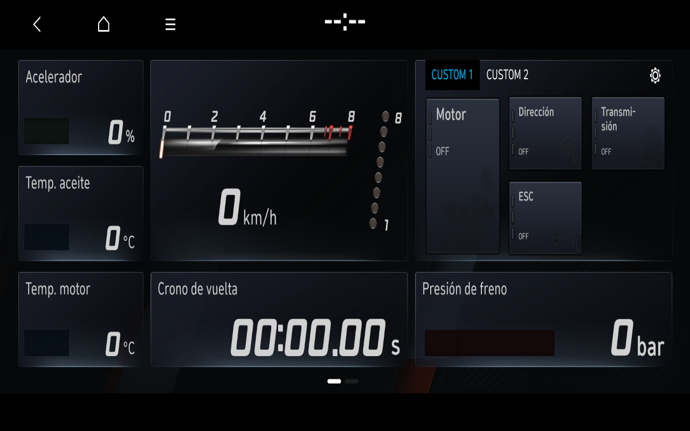
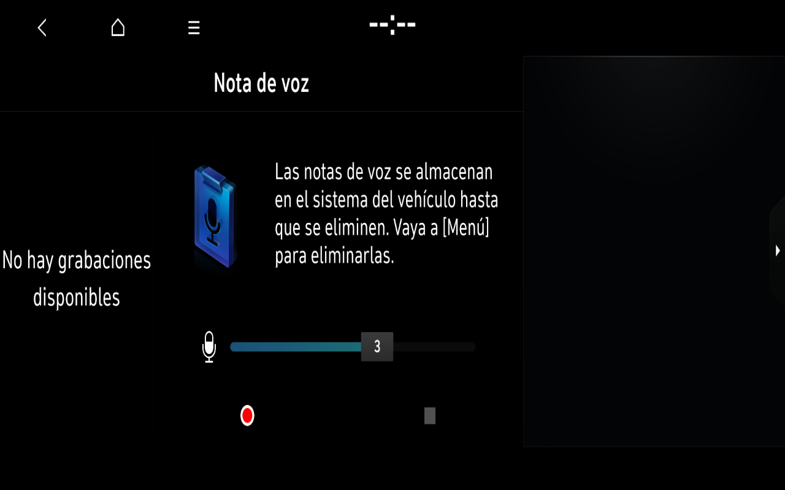
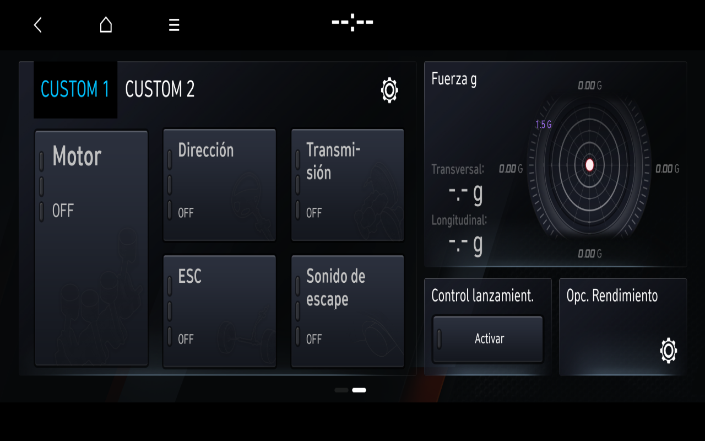
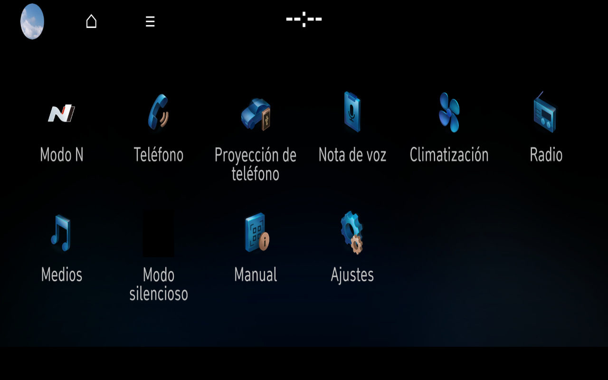
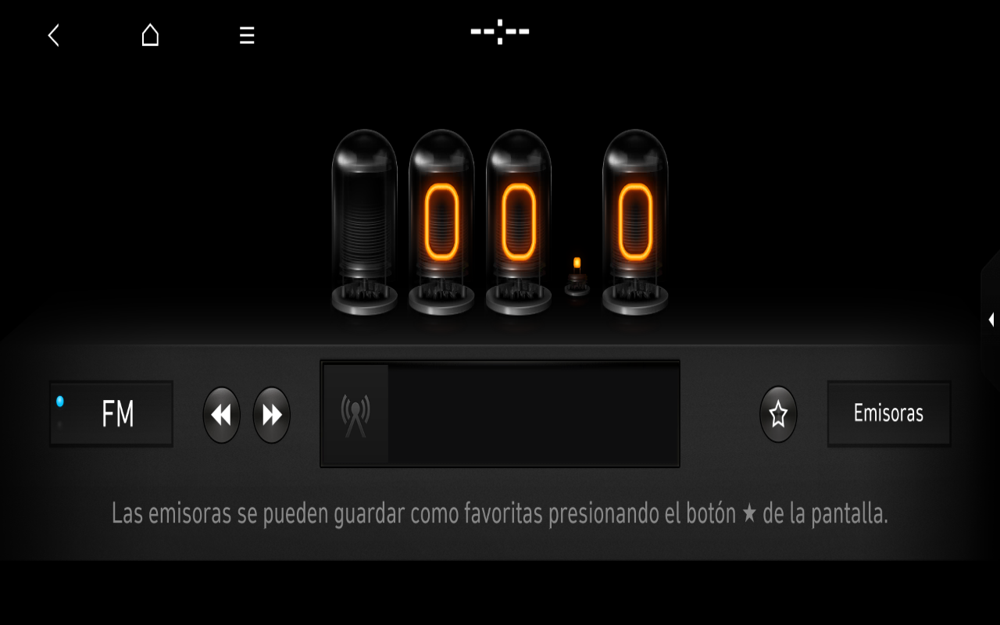

# Hyundai i20 N Infotainment Lab

**Independent, community-driven reverse engineering and offline emulation research.**  
**Status (8 November 2026):** experimental. A frozen Windows launcher (v1) runs original Home, N Mode, Radio FM UI (no tuner) and Manual in Spanish with native Home returns, offline in QEMU. Development overlays additionally show original Settings categories, Bluetooth settings, Sound/Equalizer, Voice Memo and the original clock; they are not yet integrated. Phone, Media UI, Madrid timezone and Navigation remain open. Full details: **[docs/STATUS.md](docs/STATUS.md)** · [application matrix](docs/APPLICATIONS-INTEGRATED.md) · [Windows launcher](docs/WINDOWS-LAUNCHER.md).

Owner-authorised screenshots from the private lab. Earlier per-checkpoint summaries that used to sit at the top of this README are kept in [docs/history/README-status-to-2026-11-08.md](docs/history/README-status-to-2026-11-08.md).

We are studying how selected software components from a Hyundai i20 N infotainment environment work, with the long-term goal of reproducible offline testing and UI-customization research. The private test lab uses QEMU, Linux, Weston/Wayland IVI, EGL and original Qt 5.4.1 components.

> **This is not a downloadable OEM emulator, firmware mod, unlock tool or vehicle flashing kit.** No original Hyundai firmware, binaries, extracted QML, textures, maps or other proprietary assets are distributed here.

## Obtain the firmware legally (not hosted here)

**Official Hyundai Europe / Spain navigation and infotainment update portal:** [Hyundai update site](https://update.hyundai.com/EU/ES/home). Owners can [search by model or VIN](https://update.hyundai.com/EU/ES/search) and select **i20 N**; verify the exact **BC3N** variant and software version before obtaining any update. The July 2026 official version list included **`BC3N.EUR.S5W_L.001.001.260128`**, but availability and compatibility can change.

**This repository contains no original Hyundai firmware, decrypted OEM files, maps or map databases.** Each researcher is responsible for obtaining suitable materials independently and respecting applicable terms. See [firmware sources, compatibility notes and publishing rules](docs/FIRMWARE-SOURCE.md).

The original vehicle may depend on **GPS/GNSS, cellular modem/SIM, online services, MICOM, and vehicle networks**. In our isolated QEMU lab, missing inputs may be supplied through **clearly disclosed, deterministic synthetic test adapters**; they are not real vehicle readings or a full replacement for Hyundai navigation or connected services.

## Tools to inspect your own update (no OEM data included)

To reproduce **read-only firmware examination**, see [firmware analysis toolchain, third-party decryptor references and source-provenance notes](docs/TOOLS-AND-LOCAL-EXTRACTION.md).

This repository now provides an [original offline inventory scanner](tools/firmware_inventory.py) (with [synthetic-only tests](tests/test_firmware_inventory.py)) to identify file/container headers, basic ELF architectures, sizes and optional SHA-256 hashes. It **does not decrypt, extract, patch or publish firmware**. Obtain a compatible European i20 N update independently from Hyundai; see the [official source](docs/FIRMWARE-SOURCE.md).

**Not claimed:** successful decryption or boot of the unchanged Hyundai OEM **kernel**. Our private reports verify running selected **OEM userspace** components in a compatible QEMU Linux environment; that is not equivalent to running the exact original head-unit kernel. The specific local `update_decryptor` build and private wrappers have not yet been audited/exported to the public repository.

## Latest owner-approved QEMU screenshots (7 November 2026)

These four screenshots are a curated subset from completed, offline private runs. They show the original Spanish Home and Radio applications plus the two-page original N Mode Track UI. The N Mode run uses the documented `nm2`/`pf0` laboratory selection and software-decoded texture fallback; vehicle sensor values are unavailable or zero. The images do **not** establish RF reception, audio, physical-vehicle integration, native ASTC rendering or GPU acceleration.

| N Mode Track dashboard | N Mode Track page 2 |
| :---: | :---: |
|  |  |

| Original Home menu after N Mode return | Original European Radio FM |
| :---: | :---: |
|  |  |

The lossless WebP files are pixel-exact conversions of owner-approved PNG captures. Their source run IDs, hashes and limitations are recorded in the [image provenance note](docs/images/2026-11-07/README.md), the [N Mode MY23 audit](docs/PROGRESS-2026-11-07-NMODE-MY23-TEXTURES-AUDIT.md) and the [Radio viewport report](docs/PROGRESS-2026-11-07-RADIO-VIEWPORT-EXPORT.md). Hyundai GUI visuals and trademarks remain the property of their owners and are not relicensed under this repository's MIT license.

## New: original Confirm → navigable Home screenshot sequence (1 November 2026)

**Three owner-approved screenshots from the same private run `20261101T095842Z-17749-1`.** The sequence is not proof of unmodified OEM boot timing: this controlled test used a **reversible Standby QTimer extension (10 → 45 seconds)** and experimental Weston Home foreground repair. The screenshot at +55 seconds is **partially rendered**; a later genuine pointer drag reached the complete original Home second page.

| OEM Standby / Confirm screen | Original Home after return (+55 s, partial frame) | Original Home navigable after drag (complete page 1) |
| :---: | :---: | :---: |
|  |  |  |

**Important:** the first screenshot is the Standby/Confirm visual state in the logged sequence; the original request and input-event provenance are established by the separate private run logs, **not by screenshots alone**. See [technical investigation and timing caveats](docs/PROGRESS-2026-11-01-HOME-CONFIRM-LAUNCHER-RADIO.md).

## Screenshots from the private QEMU lab (30 October 2026)

These **owner-supplied screenshots** show the original Hyundai Home application running inside a disposable QEMU/Weston guest. They document visible test results, **not** a finished emulator or verified launch of N Mode or other applications.

| Home inicial (110 s) | Segunda página original | Pulsación en icono N |
| :---: | :---: | :---: |
|  |  |  |
| Initial fullscreen Home (untranslated labels remain) | Original menu page 1 reached after a pointer drag | Click routed to original Home; later Codex logs identify `appid=500` and a missing appmanager service |

The 170-second capture supplied by the owner duplicates the page-1 frame, so it is not stored a second time. Images are optimized WebP versions of the supplied captures; no original firmware, extracted textures, binaries, or QML are provided. Hyundai GUI visuals and trademarks remain the property of their owners and are **not relicensed** by this project's MIT license.

## Using another coding agent

This project provides [CLAUDE.md](CLAUDE.md) for Claude Code, [AGENTS.md](AGENTS.md) for other agents, and a shared [AI handoff](docs/AI-HANDOFF.md). These public documents describe the research but **do not** contain the private VM or proprietary input files.

## Where the community can help

- Qt 5.4.1 / QML and Wayland IVI surface visibility and layering
- Linux graphics / EGL / Mesa software rendering
- ASTC texture handling with legally shareable synthetic test assets
- Hyundai/Kia software architecture documentation **without posting OEM files**
- Reproducible offline experiments, original Python/Bash tooling and tests

See [open Issues](../../issues), [contributing guidelines](CONTRIBUTING.md), and [security guidance](SECURITY.md). We encourage small, well-evidenced pull requests. Please mark findings as **runtime verified**, **static analysis**, or **hypothesis**.

## Publication rules

Do **not** submit original firmware, root filesystems, executable binaries, proprietary QML, Hyundai textures, map data, keys, personal identifiers, full core dumps or raw vehicle logs. Do not upload private laboratory directories or VM disk images. Use a clean public working tree, not the private lab checkout.

This research is designed for **offline, isolated software experiments**. The repository does not support CAN injection, interactions with a running vehicle, bypassing vehicle security, or flashing physical head units.

## Licensing and disclaimer

Original code and documentation contributed to this repository are available under the [MIT License](LICENSE), where contributors have the right to license them. The license **does not apply** to Hyundai/Kia or other third-party proprietary works.

This is an unofficial independent project. It is not affiliated with or endorsed by Hyundai Motor Company, Kia or their suppliers. Product names and trademarks belong to their owners.

## Acknowledgements and upstream research

This project has benefited from publicly shared research and materials from the following independent projects. **Thank you to their maintainers and contributors:**

- **[Hyundai/Kia Gen5W navigation firmware research — laralbir](https://github.com/laralbir/hyundai-kia-gen5w-navi-firmware)**: useful reference for studying Gen5W firmware structure and related research.
- **[HKG Gen5W ReverseEngineer — cantcs](https://github.com/cantcs/HKG_Gen5W_ReverseEngineer)**: useful reference for reverse-engineering workflows and Hyundai/Kia Gen5W investigations.

We acknowledge their prior work and ideas. This repository is **not a fork** and does not claim their work as its own. The precise file-level provenance of any adapted scripts or code is still being audited: **do not publish copied upstream code until its origin, license and required notices are verified**. See [PROVENANCE.md](PROVENANCE.md) for the attribution checklist. The platforms researched by these projects may differ from the i20 N BC3N variant.

