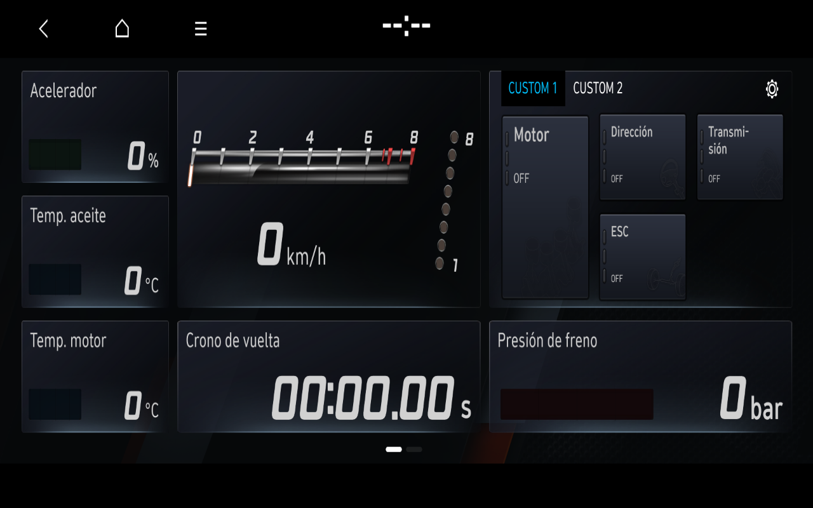
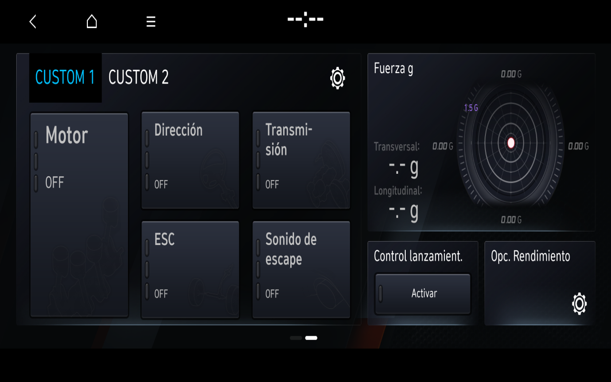

# BC3N25MY: original Spanish N Mode artwork and native icon cycle

The preferred software profile remains **BC3N25MY**. The physical vehicle remains reported as **BC3N i20 N MY23, Spain/Europe, software updated in 2025**. This checkpoint extends the [native boot and capability-removal control](PROGRESS-2026-11-07-BC3N25-SOFTWARE-PROFILE.md).

A fresh offline overlay changes only the decoded texture pack: 66 previously verified original textures are added to the 21-texture control. CarType81/HighPerformanceCar1, European country 5 and Spanish language 7 remain constant. Original MICOM and AppLauncher produce native `-vv:81 -pf:1 -nm:2`. Neither the local N Mode capability module nor the argv adapter is present in the payload or actual Home maps/environment.

## Verified result

The original Spanish Track dashboard and second page display their observed artwork. A real VNC swipe changes pages. Original Home returns to its complete aligned menu. Clicking the original Home N Mode icon emits 500/5185 **from AppHomeScreen PID 1495**, followed by original manager requestShow500 and the rendered original dashboard. A second native 11/30 return and further Home page drag succeed. Final Home is pixel-identical to its initial reference.

N Mode 500 is an integrated original Home view: original AppLauncher starts AppHomeScreen, and the tested IVI surface 1001 belongs to that original process. This is not a new standalone N Mode executable. The existing compositor fits a 1920×720 content buffer into the 1280×730 app area on 1280×800 output; its prior timing/input/frontend adaptations remain explicit.

Four OEM process identities plus Weston remain unchanged in seven health samples. All 55 screenshot exports verify, no manager AppKill appears, and shutdown is clean. This is a bounded UI audit, with no new dedicated ten-minute stability claim.

## Owner-authorized, reviewed screenshots



Original first page after the native Home icon, with CPU-decoded original textures. Zero/OFF values are original defaults without sensor feeds; no driving telemetry was fabricated.



Original second page in the same overlay. Only page navigation and Home controls were used; custom-mode, vehicle-setting and launch-control buttons were not activated. Both images preserve the complete 1280×800 source frame, without cropping or retouching. Lossless WebP decoding is RGB-identical to the original PNGs. [Image hashes and provenance](images/2026-11-07/README.md).

## Resource and reproduction checks

The installed additional pack matches its existing SHA256 `3cb9231ae43a22329dd9b6a60adb46e4c6d645a16ec6ed44d957bcd0c22f97a5`. The guest verifies 132 original sources and 66 decoded outputs, plus 42 sources/21 outputs for the baseline. The earlier 66 PNG/RGBA roundtrips remain valid because the pack is unchanged. One empty original pair remains excluded. Total installed N Mode fallback: 87 textures. These are decoded Hyundai images, **not native ASTC rendering or guest RTX acceleration**. No source texture, archive, firmware, binary, QML or raw trace is published.

The new native alternative in the additional-pack guard requires the explicit native81/HighPerformance1/Spanish7/capability0/argv0 combination; 12 missing/incorrect native conditions are rejected. The old nm-only profile and frozen references are preserved. Actual guest arguments and installed source/output hashes are checked after execution.

Private checkpoint: `20261107T133726Z-replay-65fbbf-1`; separate frozen profile `nmode-bc3n25-native-render-ui-verificado-20261107`. The public read-only verifier was run against its actual evidence:

```sh
python3 tools/verify_native_bc3n25_evidence.py /path/to/private/completed-run
```

In the private laboratory, replay uses `python3 host/windows-session.py start --profile nmode-bc3n25-native-render`, then the reviewed VNC navigation/icon/Home actions; stop uses `python3 host/windows-session.py stop`. The public repository requires independently obtained compatible firmware and does not contain the private VM/profile payloads.

Next: check Radio compatibility with this native identity before promoting it into the stable Windows Home/Radio launcher; investigate Voice under native81/HighPerformance1 separately with thread/stack evidence if needed. Recording, audio, sensor functions, navigation, connectivity and complete vehicle emulation remain unverified. Phone remains hardware-dependent without Bluetooth hardware or a paired smartphone.
