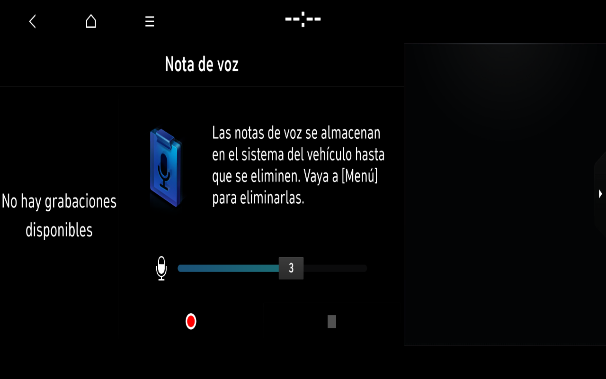

# Original Spanish Voice Memo UI and native return — 7 November 2026

## Verified result and boundaries

The first two separate offline overlays displayed the original **Nota de voz** interface, logical application 117 inside original AppMediaPlayer. Original AppLauncher starts the provider, original Home emits `(304,117,28,1,0)`, and ApplicationManager reports actual drawn 117. The interface displays original Spanish text including **No hay grabaciones disponibles**. A visible original return control generates **`(3,117,1,1,0)`**, handled by the original manager's Back/history path to Home 11. This is not a fabricated success reply or a replay of Home 11/reason 30.

The first successful trial (`20261107T112403Z-replay-df4177-1`) used a passive Qt window observer after earlier trials retained an empty IVI surface. The correlation is not an established causal fix: instrumentation can change timing. Its native 1920×720 presentation was cropped by the 1280×800 output. Native return and another real VNC Home page gesture completed; final Home pixels exactly matched the initial reference.

A subsequent independent overlay (`20261107T113954Z-replay-87a110-1`) held that observer and the original media runtime configuration constant and changed only destination fitting. Three genuine manager getters had to agree on 117 before the lab compositor fitted the owned, already visible 1920×720 MediaPlayer surface in active layer 102 to 1280×730. The fit does not force drawn application, the first buffer, foreground, opacity, layer or frame callbacks. Original Spanish empty-list content was visible within the fitted output; native Back returned to aligned Home and another mouse drag worked. The final Home image differs only in its page-indicator rectangle. All 59 screenshot exports have verified local hashes and secondary Windows copies. Shutdown was clean.

This is **partial original UI functionality**, not proof of voice recording, microphone input, playback, audio, full MediaPlayer operation or complete multimedia emulation. No recording, playback or deletion operation was used. Missing ASTC artwork remains separate from the proven native transition. No new ten-minute stability result is claimed.

## Actual components and explicit laboratory configuration

- The original AppMediaPlayer executable owns IVI1002 in these trials; this is not an in-process Home subview or a substitute application.
- The genuine original catalog `/app/share/AppMediaPlayer/res/languages/AppMediaPlayer_es_ES.qm` was opened successfully. Region 5 and language 7 remain the observed European/SpanishEU arguments.
- The earlier loader failure is resolved in this isolated profile using a temporary runtime link to the hash-verified original 45-step TSE library. This follows the inspected OEM 45/75 selection mechanism but does not prove the vehicle's physical amplifier variant or provide an AMP response.
- The measured original Qt window is 1920×720 and can become visible/exposed with a real buffer. The earlier zero-sized-window hypothesis is not supported by this successful observation. Actual rendering is llvmpipe / LLVM 3.9 with GLES 3.0 / Mesa 13.0.6, not the host RTX renderer.
- Existing explicit boot UART fixtures and software/timing/IPC adaptations remain. No new CAN, MICOM or D-Bus hardware replies, sensor readings, recordings or backend data were fabricated. Voice Memo QML and translations were not edited; previously disclosed private Home/Standby adaptations remain in the profile.
- Owner target remains **BC3N i20 N MY23, Spain/Europe, vehicle software updated in 2025**. The existing CarType0/LX2 fixture is still not a complete OEM vehicle identity. Do not select BC3N25MY from the update year.

The earlier empty-buffer trials remain valid negative evidence. Original show-window requests and provider registration were insufficient by themselves; this report requires actual content, surface, native input, genuine return and further Home navigation. The geometry adaptation and the observer are separate modules; neither is promoted into the frozen Home/Radio baseline.

## Reproducible own diagnostics

```sh
python3 tools/verify_voice_memo_evidence.py /private/path/to/completed-fitted-run
```

Python3 and Pillow are required. The offline verifier checks owned original surface, original requests/native Back, Spanish catalog open, process identity, geometry, local hashes, Home comparison and clean shutdown. It does not execute firmware, send input or establish screen identity without independent visual review. Private diagnostic output is not redistributed here.

[The original read-only Qt observer](MEDIA-WINDOW-OBSERVER.md) records window getters and forwards Qt methods. Its source and build instructions are provided without compiled modules or OEM fixtures. The private trial combined it with an existing unchanged Home capability module. Keep the instrumentation's timing influence explicit until isolated controls establish a reproducible cause and solution.

Earlier verified UI IDs 10/11/77 and original integrated N Mode 500 remain separate references. The original Manual and Settings subviews are not additional standalone applications. Static metadata rows must not be counted as usable apps. Phone/projection/media-source blockers and excluded update/diagnostic routes remain recorded separately.

## Next work

The requested texture restoration and another native cycle are now verified below. Isolate initial presentation timing from observation overhead, extend the safe offline application audit, and preserve all functional references. Keep proprietary assets, firmware, maps, QML, binary files, screenshots and traces private.

## Latest closed texture trial

A third independent overlay, `20261107T115821Z-replay-f1b778-1`, added only 35 actually requested original ASTC resources decoded on CPU. All 70 source files matched the immutable base and all 35 PNG/RGBA roundtrips passed. All 35 target PNG paths were absent in the base, so no original PNG was overwritten. Original ASTC headers/payloads remain preserved in the disposable overlay. This is decoded original imagery, not native ASTC rendering or recreated artwork.

The late screenshot shows the original blue Voice Memo icon, microphone, level graphic and controls with readable Spanish empty-list text. No record/play/delete/gain action was used. The early screenshot was still dim and moving; it is retained as an intermediate animation frame, not a failed-app claim. Native Back 117/1 returned to the aligned Home menu and another real Home page drag succeeded. Final Home differs only in its indicator. All 65 local screenshot hashes passed; the guest powered down cleanly. The offline verifier passed against both fitted references. This remains a UI result under the disclosed instrumentation, with recording/audio and timing causality unverified.

## Owner-authorized visual evidence



The original empty-list screen is visible and legible; the right assistant pane has no content. The microphone, level and control artwork is restored from original textures. No recording or audio operation was used. This is a full 1280×800 screenshot from the completed texture trial, converted losslessly without cropping or reconstructing content. See [capture provenance and limits](images/2026-11-07/README.md).
