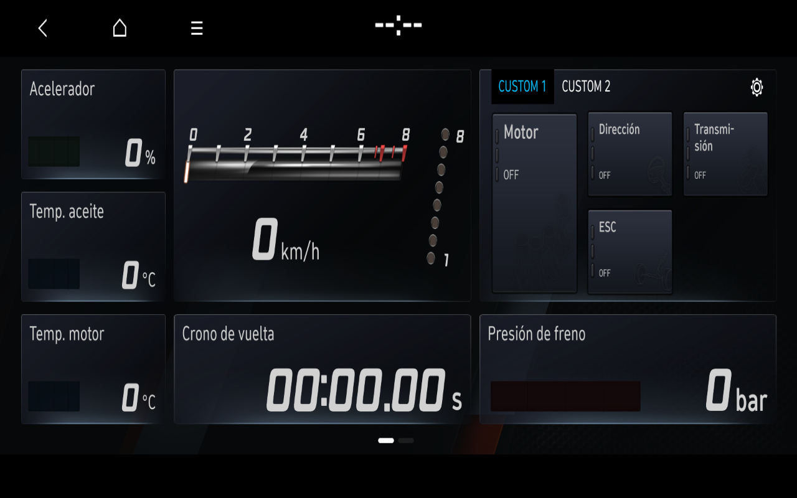
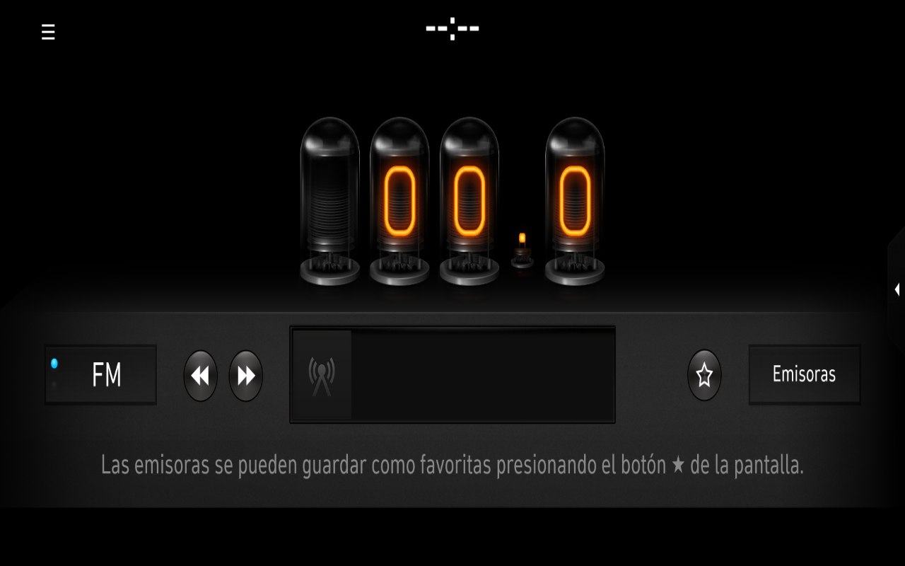
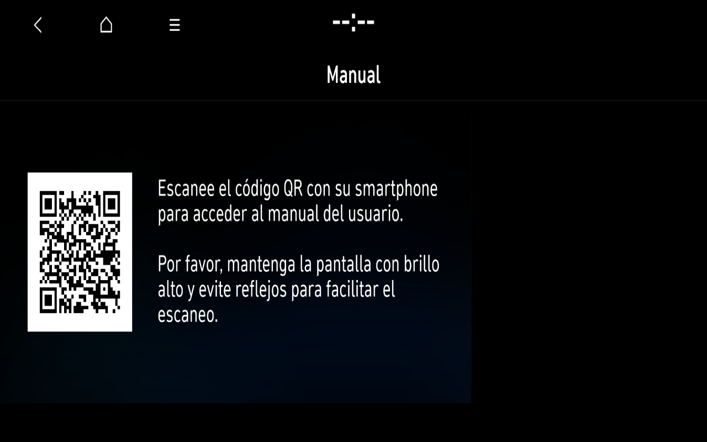

# Producto integrado y lanzador Windows — 7 noviembre 2026

Se ha instalado un ejecutable WinForms propio y un acceso directo de escritorio en el PC del propietario. Inicia WSL y el perfil integrado BC3N25MY con un overlay nuevo, abre el visor al comprobar Home, ofrece ratón, estado y registro, y apaga la VM desde un botón. No hace falta abrir Ubuntu ni introducir identificadores de ejecución. La validación final desde el acceso directo completó Home → N Mode → Home → Radio → Home → Manual → Home y otro arrastre, todos con imágenes españolas completas. El apagado desde Windows dejó cero QEMU/controladores del laboratorio.

**Evidencia comprobada desde Windows:** arranque real del ejecutable, ventana nativa y navegador automático al llegar a Home. Una segunda apertura deja una sola ventana y la misma VM. Los botones reales Detener e Iniciar completan un apagado limpio y un reinicio inmediato en otro overlay. Un fallo inicial por reserva de puerto en TIME_WAIT se corrigió con SO_REUSEADDR, conservando el rechazo de un listener activo. La política de PowerShell impidió un primer script de pruebas; se utilizó una herramienta .NET propia, sin cambiar la política ni desactivar protecciones.

En una misma sesión integrada aparecieron Home original, N Mode Track, Manual y Radio FM originales en español. N Mode y Manual volvieron a Home alineado. Radio mostró su interfaz completa con 0.0 MHz, sin sintonizador ni estaciones inventadas. **Una vuelta posterior desde Radio dejó Home sin buffer aunque el gestor indicó 11; ese ciclo no se da por superado.** El primer recorrido Windows sí mostró Radio y regreso alineado. Una segunda sesión y el arranque final desde el acceso directo sí completaron Radio → Home con una única pulsación del icono de casa después del dibujo completo; el menú volvió idéntico a su referencia y siguió navegando. La causa del caso negro con entradas durante la transición no está aislada, y no se declara corregida para todas las secuencias.

El hardware ausente no se simula con telemetría falsa. N Mode conserva ceros/OFF originales, y no hay smartphone, receptor de radio, micrófono, GNSS ni servicios Hyundai en línea. El perfil queda offline con `-nic none`. La ficha física declarada sigue siendo i20 N MY23 España/Europa, actualizado en 2025; BC3N25MY es la selección de software preferida del propietario.

La exploración de Ajustes y Medios usa el AppLauncher original, hashes de los ejecutables comprobados y solicitudes originales. Un proceso o una respuesta D-Bus no bastan para clasificar una aplicación como navegable. AppNavi no existe en el montaje de esta sesión; el paquete recuperado en el host no demuestra mapas europeos/españoles instalados ni licencia válida. No se ejecutan actualizadores, ingeniería, reset, eCall ni comprobaciones de licencia omitidas.

El frontend publicado es código propio y requiere un laboratorio privado preparado. No se distribuyen firmware, VM, bibliotecas, QML, texturas decodificadas, mapas, licencias ni trazas. [Uso y contrato del lanzador](WINDOWS-LAUNCHER.md). Los perfiles funcionales anteriores permanecen congelados e independientes. El emulador completo y la compatibilidad de todas las aplicaciones no se consideran terminados.

Imágenes completas re-encodificadas sin pérdidas, autorizadas y revisadas; [proveniencia](images/2026-11-07/README.md). No se publican los fallos visuales ni la captura del navegador con pestañas privadas.

## Prueba de entrega completada

La sesión final arrancó desde el acceso directo a las 15:48:41 UTC y habilitó el visor tras Home a las 15:53:04 UTC. El recorrido con iconos originales completó a las 15:58:47 UTC. Las ocho comparaciones de retorno/pantalla usaron la región 0,100..1280,690 contra imágenes completas revisadas; ninguna tuvo píxeles con diferencia mayor de 8, y los retornos de Home fueron exactos en esa región. El arrastre posterior mediante Windows user32 → Brave → noVNC → QEMU volvió a producir las dos páginas esperadas, con coincidencia exacta.

El primer intento de ratón de Windows se bloqueó sin entrada porque el navegador no tenía el foco; UIAutomation.SetFocus lo resolvió sin cambiar seguridad. Un gesto inverso demasiado largo sobre un icono abrió la edición original de iconos; Atrás recuperó el menú idéntico. El comprobador final usa la franja inferior libre. Estos controles negativos se conservan privados.

El botón Detener se invocó a las 16:04:22 UTC y el lanzador indicó Detenido a las 16:04:26 UTC. El kernel registró Power down y no quedaron QEMU ni controladores propios. Los cinco procesos principales mantuvieron PID/tiempo de nacimiento durante la fase interactiva. **Radio reinició por decisión del gestor durante el arranque, antes de la entrega del control; después conservó un único propietario de superficie durante el ciclo.** No se declara estabilidad perfecta desde el primer proceso del boot.

La comprobación offline `tools/verify_product_delivery.py` exige secuencia, imágenes/referencias, identidad de software, red desactivada, procesos principales, propietario de Radio después de Home medido, entrada Windows registrada y apagado. Requiere evidencias privadas independientes y revisión visual; no distribuye ni demuestra por sí sola procedencia OEM. No se ejecutó otra ronda aislada de Qt/idioma ni un ensayo dedicado de diez minutos: el tiempo transcurrió en la exploración y validación del producto.

Las funciones disponibles y pendientes están en [la matriz integrada](APPLICATIONS-INTEGRATED.md). El resultado es un laboratorio utilizable con tres vistas/aplicaciones OEM además de Home; quedan pendientes la robustez ante todas las secuencias, las aplicaciones adicionales y el resto del multimedia.

El perfil conserva adaptaciones propias de temporización de Qt/manager/launcher, entorno IVI, compositor y decodificación CPU de recursos originales. Este resultado no afirma arranque con plazos OEM intactos, ASTC nativo ni aceleración de la RTX.
