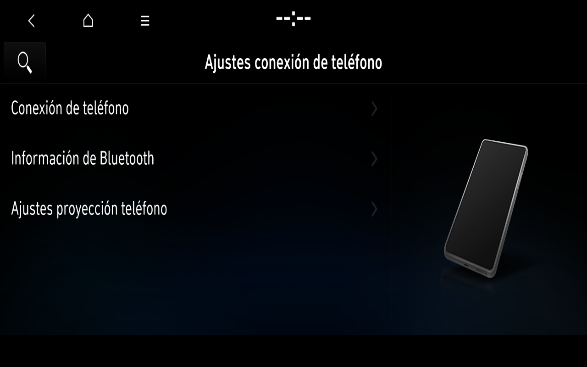

# Original offline Bluetooth connection settings

Original BluetoothHMI now provides the Spanish Connection Settings interface in the BC3N25MY development profile. It completes the original lifecycle and draws content; the provider PID alone is not counted as an application result. Accepted Windows v1 and its frozen profile remain preserved. No v2 or packaging work was performed.

## Verified behavior

- Original AppLauncher starts provider121 with original European/Spanish arguments.
- The original service registers and replies to genuine Peer.Ping requests. The current profile includes original PAS/default data and the OEM D-Bus subscription limit. This does not isolate one sole cause against every earlier profile difference.
- The original Home Settings icon requests logical53/reason68. ApplicationManager calls original Show and confirms53 as the drawn application.
- Spanish Connection Settings → Bluetooth information → native Back → complete Connection Settings → native Home works with real pointer input. Home is checked visually and with the original transaction-finished signal and three matching getters.
- The internal Phone projection settings show the original Spanish Android Auto and Apple CarPlay pages. Pointer input switches their tabs; native Back returns to the complete settings root and native Home returns to Home, checked visually and against the original transaction state. Enable/split-window checkboxes were not changed. This is BluetoothHMI settings content, not AppProjection110 or a working projection connection.
- The view initially requested a1920×720 destination on a1280×800 output. The lab controller now fits its destination to1280×730 after the native state and geometry checks pass; source1920×720, layer and opacity remain unchanged. Initial transition frames must not be reported as the final layout.

The first run used IVI1003; the independent cold run used IVI1002. Selection uses the actual process owner and native foreground state, not a fixed surface ID. Information was viewed without editing a device name or pairing credential. No devices were paired or invented.

## Resource recovery and scope

A separate explicit CPU opt-in for the original BluetoothHMI process restored its original phone illustration after an original terminate/launch cycle. Its640×540 ASTC4×4 upload matched an independent pinned decoder by original header, packed payload, decompressed blocks and decoded RGBA hashes. This is CPU decoding and native RGBA upload, not OEM ASTC rendering or GPU acceleration. The first opt-in was installed in guest RAM for a live test. A subsequent independent overlay selected the same adapter from boot and verified the complete Spanish root, actual original illustration upload, native Home return, transaction completion and three matching getters. Firmware textures remain unchanged and private.

The Bluetooth Settings UI can be used offline, while the actual BlueZ/vendor adapter and paired smartphone remain absent. This does not demonstrate phone calls, A2DP playback, real Android Auto/CarPlay projection or external connectivity. The original clock now supplies VM time to Home; [Madrid/DST and combined Settings integration remain pending](PROGRESS-2026-11-08-ORIGINAL-CLOCK.md). Target is Spain/Europe; software preference BC3N25MY and physical MY23/update2025 remain distinct.

[Incremental viewport patch and limits](../tools/ivi_geometry/README.md) · [CPU adapter source/provenance](../tools/experimental_astc_cpu/README.md) · [Reviewed image provenance](images/2026-11-08/README.md).
