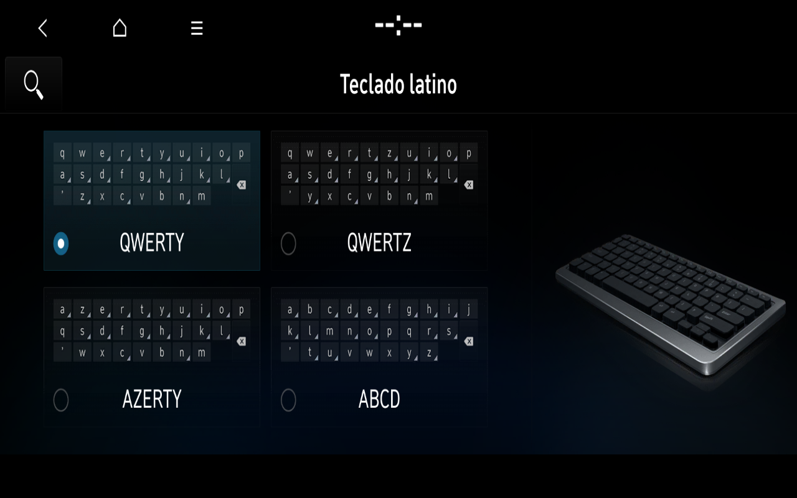

# Original Settings categories and CPU ASTC decoding

Development on 8 November 2026 adds original Spanish Settings pages beyond Sound, General and Display. The accepted Windows v1 profile remains preserved; these development results do not imply that every category is integrated or complete. Software preference remains BC3N25MY; the physical car is MY23 Spain/Europe, updated in 2025.

| Original logical view | Verified development behavior | Remaining limits |
| --- | --- | --- |
| Theme/layout 480 | Screensaver options rendered; native Back returned to Settings root | Split-window internal page and some artwork still need audit; no preferences changed |
| Buttons 62 | Original i20 N left/right N-button pages; real mouse switches tabs; native Home return | Physical steering-wheel inputs absent; assignments were not changed; some illustration resources remain |
| Profile 362 | Native factory Driver 1 page and its name/image/delete-options page; native Home return | No account, name, avatar or deletion action performed; avatar artwork remains incomplete |
| General 56 | Original Spanish persists through a native terminate/launch cycle; Latin-keyboard previews now render | Other General pages retain their documented limits; Update/Reset/Variant operations excluded |

The original AppLauncher performs the provider lifecycle. ApplicationManager and the IVI window manager perform the transitions. The lab adapts destination geometry only after concordant native getters and checked owner/layer/source geometry. A screenshot can show complete Home while the OEM transaction is still active: the input gate now also requires the original `screen_transaction_status(1,false)` and three concordant manager getters from the verified service owner.

## Resource improvement

A private 126-texture pack covers resources actually requested in the audit. Original headers/packed bytes, dimensions, decoded RGBA and PNG roundtrips were verified; four empty recovered payloads were excluded. Resources remain private and installation occurs only in a disposable overlay.

The new CPU upload adapter then restored all four original Latin-keyboard previews without adding manual PNGs for those previews. It preserves the OEM loader, intercepts supported compressed uploads, decodes original blocks and invokes native RGBA uploads. Linux output matched the verified Windows decoder on all 126 private fixtures. A live 373×186 ASTC 6×6 upload independently matched both source and decoded-pixel hashes. The renderer was software llvmpipe inside the guest; no RTX acceleration or OEM ASTC rendering is claimed.

The native Home return after this page was checked with both complete content and the original transaction signal. [Image provenance](images/2026-11-08/README.md) · [Experimental source and build](../tools/experimental_astc_cpu/README.md).

## Media and remaining work

Earlier original Media117 Show calls returned int1 within about two seconds but presentation did not complete; the manager rolled back and retried at about 45 seconds. That was a presentation-stage failure, not proof of a missing microphone or a failed Show RPC. The current BC3N25MY development session completed Home → original Spanish empty-recordings UI → real mouse Back → complete Home, including the native transaction-finished signal. AppMediaPlayer owned IVI1003. No Media CPU-upload calls were observed in this positive run; the 126-texture pack was already installed. This result does not isolate which initialization/resource condition resolved the earlier presentation failure. Recording and playback remain untested. No recording, playback, tuner, GPS, Bluetooth, online service or telemetry is fabricated.

AppSetup still has latency, artwork and untested-category work. Its QML and translations remain original. The inherited Home variant override remains documented in the earlier provenance; this result does not establish globally unmodified QML. No firmware, decoded source textures, map, executable, private trace or credential is published.
