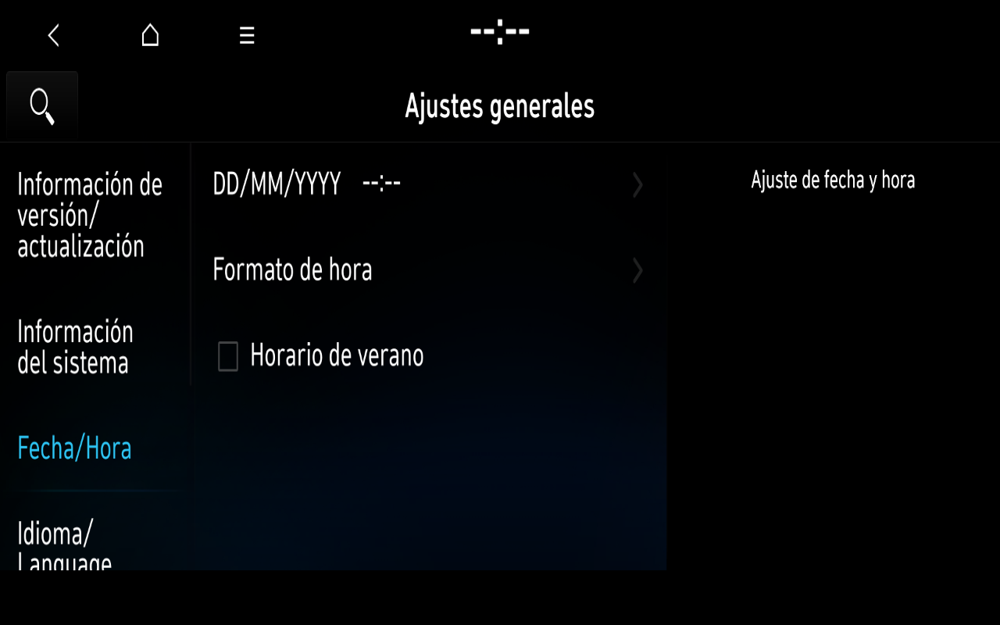

# Ajustes originales: General en español y registro D-Bus

El desarrollo aislado BC3N25MY ya completa Home → Ajustes → General → páginas internas → Home mediante ratón y controles OEM. El producto Windows aceptado permanece intacto; Ajustes todavía no se incorpora como aplicación completa.

## Resultado comprobado

- El bus del laboratorio omitía el límite OEM de suscripciones. ApplicationManager recibió al menos240 errores completos `LimitsExceeded`; solo recibía las teclas de las primeras dos páginas de Ajustes.
- Restaurar únicamente `max_match_rules_per_connection=50000`, como en la configuración original local, permite recibir las30 señales originales de registro de Ajustes/Media. El ensayo correctivo contiene913 llamadas AddMatch y ningún error de límite en los paquetes completos decodificados. Los paquetes truncados siguen siendo una limitación del análisis.
- General56 recibe la petición nativa, presenta contenido original y permite elegir Español mediante su selector. El proceso abre correctamente `AppSettings_es-eu.qm`; no se editan ni reconstruyen traducciones o QML de AppSetup.
- Fecha/Hora e Información del sistema aparecen en español. Un segundo overlay añade Teclado, opciones del teclado latino, Atrás a la lista, Ajustes de medios, Pantalla51/Brillo y Filtro de luz azul.
- Los botones Home originales desde General y Pantalla devuelven Home completo y alineado antes de la siguiente entrada. Los ensayos se cierran limpiamente.



Captura completa copiada sin alterar píxeles. Reloj sin datos, sin posición o señales inventadas. [Procedencia](images/2026-11-08/README.md).

## Límites actuales

AppSetup sigue siendo parcial: faltan iconos/miniaturas y algunas texturas, quedan categorías y subpáginas, y la presentación todavía tarda decenas de segundos. Treinta y nueve texturas observadas ya usan un fallback CPU verificado de los píxeles Hyundai originales; no equivale a renderizado ASTC nativo. No se repiten las baterías aceptadas de Home/Radio/N Mode/Manual ni pruebas prolongadas de estabilidad. No se ejecutan Update, Reset, Variant, diagnóstico ni funciones del vehículo.

Dos pilas reales de Ajustes muestran el GUI esperando al hilo de render; este espera eventos Wayland dentro de `swrast_update_buffers` del EGL original. El DWARF y el desensamblado originales identifican la espera de `throttle_callback`. La corrección del reloj QSG no elimina esa espera. Un ensayo EGL de intervalo0 está pendiente de validación; un primer error126 del módulo propio se reprodujo y corrigió con un fixture sintético del cargador. No se declara resuelta la latencia.

Media ya recibe requestShow117 y confirmación de superficie, pero todavía no muestra una interfaz utilizable en este perfil. Sus43 Ping reales terminan respondiendo, uno tras aproximadamente30s; el supervisor original decide terminar el proceso durante la presentación. La siguiente investigación debe separar la espera gráfica, geometría y supervisión. No se atribuye el fallo al micrófono ausente ni se inventan respuestas.

## Reproducción y evidencia

Referencias privadas finalizadas: `20261108T033026Z-replay-62a892-1` y `20261108T035144Z-replay-2a3628-1`. Contienen entradas/capturas con fecha, hashes, catálogo abierto, transiciones, resultados de retorno y registros de cierre. Firmware/base y perfiles anteriores se conservan. Home mantiene su override de variante heredado documentado; AppSetup conserva su QML original. Perfil de software preferido BC3N25MY; coche físico MY23, España/Europa, actualización2025.

El analizador propio es exclusivamente offline:

```sh
python3 tools/dbus_subscription_summary.py /private/run/setup-manager.*
```

Opera sobre hilos de un único proceso y paquetes completos; correlaciona descriptor/serial/tiempo. Ausencia de errores visibles no prueba por sí sola que todas las suscripciones funcionen. Los tests usan únicamente mensajes inventados y nombres `org.example`; las entradas y salidas diagnósticas reales permanecen privadas.
