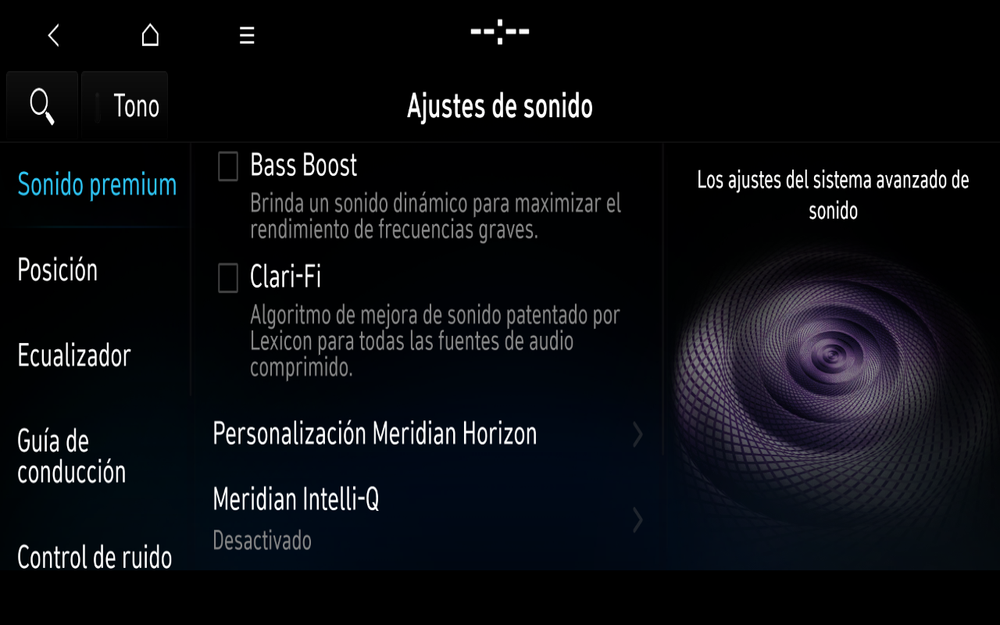
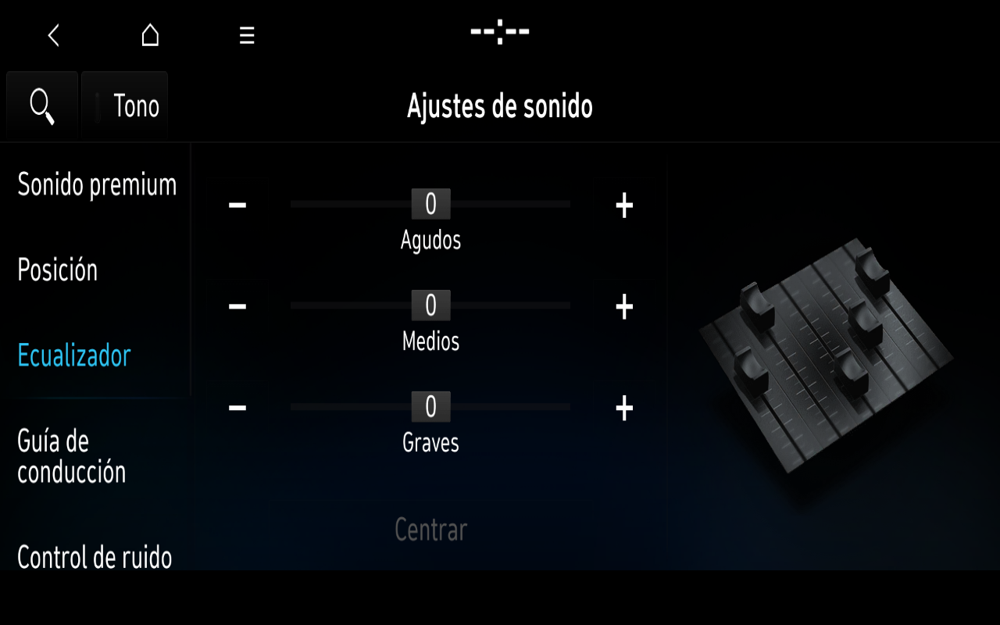

# Settings order control and original Spanish Sound

A fresh offline development overlay recovered General with the preserved Settings graphics configuration, selected Spanish through the original menu, and returned to complete original Home. The same session now presents original Sound50 content, Spanish descriptions and original artwork at the correct viewport size. Accepted Windows v1 and frozen profiles remain untouched.

## Confirmed control

The CA environment and all five payload shared-library hashes match the earlier cold Settings reference. Bluetooth and TimeManager were not started beforehand. This does not isolate graphics changes from provider order by itself.

General received native mouse input after two genuine readiness Pings. Pings at20 and45 seconds failed; at75 and105 seconds they succeeded, and the105-second screenshot contains the complete original General body. Original Spanish selection then completed its native transition. Native Home return is supported by the complete image, genuine transaction completion and three concordant manager getters. A first NoReply is not by itself evidence of a permanent deadlock.

The separate combined-provider clock-absent control still reproduced the initial stall. Changing the destination rectangle alone was also insufficient. Those variants remain experimental, rather than being promoted to the accepted launcher. Later tests must distinguish recovered delays from native manager closes and persistent waits.

## Sound scope

Sound50 shows its original Spanish premium-sound page, description text and artwork, fitted from the1920×720 original content to1280×730 on1280×800 output. Real pointer navigation displays original Position and Guidance page bodies and a complete original Equalizer page with Spanish labels and native zero values. Position/Guidance headers remained incomplete in the reviewed frames; that is a graphics defect, not a hardware-only excuse. The same original Sound process returned to complete Home through the real mouse Home control, with genuine transaction completion and three concordant manager getters. This verifies the observed UI cycle, while the missing internal headers remain a defect; it does not claim every Sound menu complete.

Three new actually requested Sound resources were independently matched against original source hashes, ASTC blocks and the pinned decoder’s RGBA pixels. The accepted module/source decoder provenance is unchanged.

[Owner authorization, frame hashes and scope](images/2026-11-08/README.md).

No balance, equalizer, gain, amplifier option or reset control was changed. The generic OEM data currently exposes several named amplifier options. Their presence is not verification of the physical Spanish i20 N audio equipment or working DSP/audio hardware. Source textures remain private and intact; the software CPU adapter decodes original requested images, not OEM ASTC hardware rendering.

## Media comparison

The original Home Media input is304/2/27, mapped by the manager to302/0/308. With no AppMediaPlayer provider, the native media count was0. After native AppLauncher100 startup and actual service-owner verification it was1, but no new Media interface appeared; the manager emitted reason902 toward app1. Its MediaGate predicate also tracks popup state and is not a direct hardware-availability proof.

Previously verified Voice Memo117 remains separate; it was not rerun to manufacture a new result. No media source, recording, phone or audio reply was fabricated. The recovered original Sound-of-Nature files were located statically; their UI and playback have not yet been demonstrated.

The full multimedia remains incomplete. No firmware, QML, OEM executables, maps, raw trace or credentials are distributed here. Official compatible firmware must be downloaded independently from the [Hyundai update site](https://update.hyundai.com/EU/ES/home).
