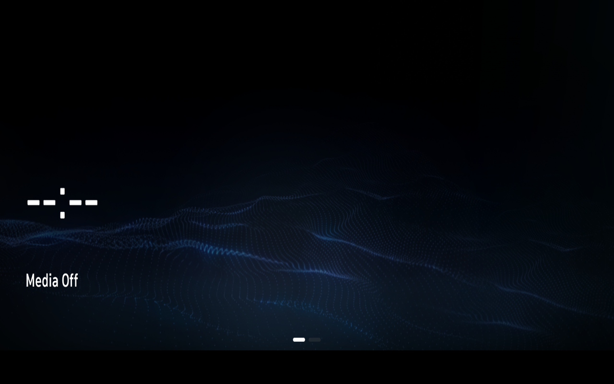

# KVM/softpipe route to original Home — 10 November 2026

## Scope

This report covers an isolated development route. It does not replace the frozen Windows launcher, distribute the private VM, or claim a complete emulator. All guests used disposable overlays and no guest networking.

## Runtime-verified result

The original launcher, ApplicationManager and AppHomeScreen reached the original visible confirmation flow and a stable original Home surface under KVM. The working graphics combination was Weston GL with Mesa `softpipe`; reference UI surfaces were assigned non-conflicting laboratory IDs before Home created its original surface.

One repeat used adaptive visual polling instead of a fixed observation delay:

- application-state prerequisite first observed at guest uptime 38.13 s;
- original confirmation action issued only after the confirmation surface was visible;
- first qualifying Home frame 19.634 s after confirmation;
- second consecutive qualifying Home frame 24.820 s after confirmation;
- QEMU start to two consecutive qualifying Home frames: **66.413 s**.

The visual gate counted content pixels and required two consecutive frames. It does not prove that every icon, resource or service was ready. The reviewed capture below shows the original Spanish Home surface with `Medios apagados`; it is deliberately not described as a complete HMI.

## CPU control

A separate clean repeat sampled `/proc` without syscall tracing for 104.7 s:

| Process | CPU seconds | Mean share of one guest core |
| --- | ---: | ---: |
| Weston | 4.03 | 3.85% |
| ApplicationManager | 1.14 | 1.16% |
| AppHomeScreen | 0.72 | 0.97% |
| AppStandbyClock | 0.22 | 0.22% |

These counters do not support CPU saturation as the remaining startup delay. They also do not identify a single blocking service.

## Renderer controls

- Recent `llvmpipe` trials reached the Home transition but Weston aborted inside the software rasterizer/GL renderer. Reusing the HMI module from an earlier successful run did not remove that abort.
- A Pixman trial stopped in the DRM backend before compositor readiness and therefore did not evaluate Home.
- GL with `softpipe` produced the stable result above.
- Host-side VirGL/`egl-headless` could not be validated because the WSL host exposed no DRM render node under `/dev/dri`. No NVIDIA/RTX acceleration claim is made.

## Timing caveat

Earlier KVM values around 115–116 s included a fixed 60 s post-transition observation period. They were completion times, not first-Home times. The historical TCG mean of 263.43 s was produced with different instrumentation, so the apparent ~3.97× difference is descriptive, not a controlled accelerator benchmark.

## Publication boundary

This repository includes only independently authored analysis code, synthetic tests, this redacted summary and the owner-approved screenshot. The VM image, firmware, binaries, QML, textures, raw traces and private run directories remain private.
