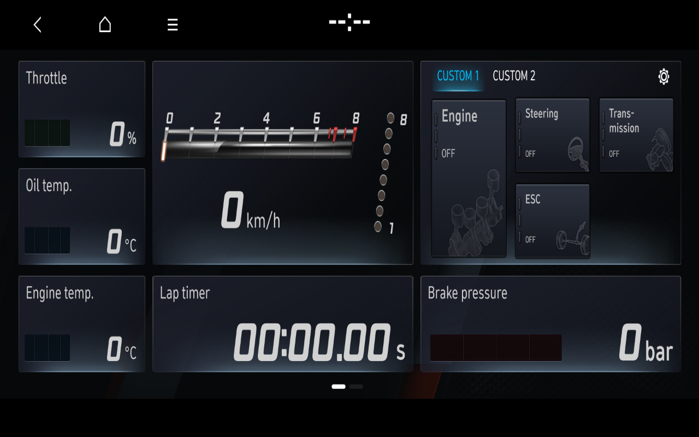
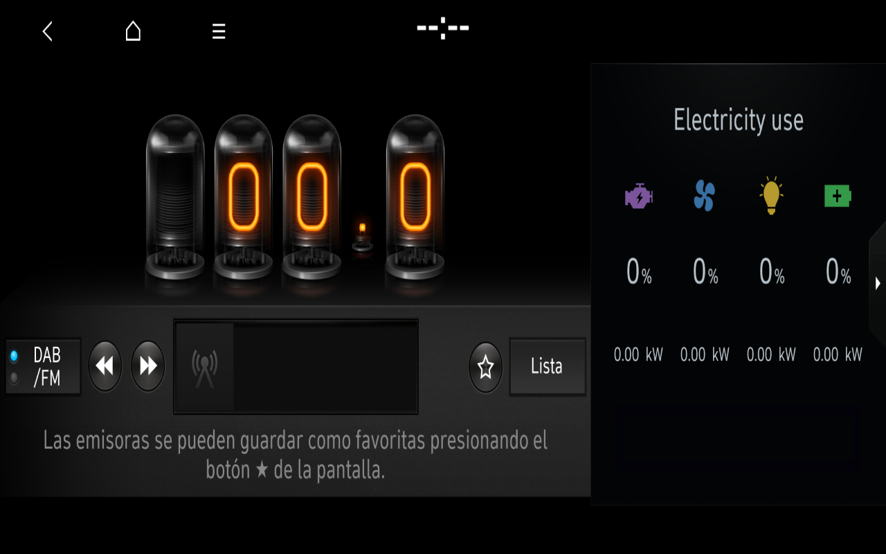

# Integrated BC3 journey and variant-aware widget finding

**Date:** 11 November 2026  
**Scope:** completed offline QEMU development run on a disposable overlay; not promoted into the frozen Windows product.

## Runtime verified

One clean run completed the original-software journey **Guest → Home → N Mode → Home → Radio → Home → General Settings → Home** and then powered off through ACPI S5. The original manager and drawing states agreed at every measured stage.

| Stage | OEM state | Time to verified visible state |
| --- | ---: | ---: |
| First Home after confirmation | `11/11` | 36.674 s after Confirm |
| N Mode | `500/500` | 3.457 s |
| Home return | `11/11` | 5.644 s |
| Radio | `77/77` | 10.097 s |
| Home return | `11/11` | 5.649 s |
| General Settings | `56/56` | 7.847 s |
| Final Home return | `11/11` | 5.647 s |

Validated Home appeared 102.241 s after QEMU start. These are measurements from this development configuration, not physical-head-unit performance claims. The final Home remained visible in the stability checkpoint and the guest shut down cleanly at about 194 seconds of uptime.

## BC3 configuration confirmed in the guest

Runtime logging reported vehicle variant `23`, region `5`, Eco Type `0`, LCD Type `3`, platform `128` and `HighPerformanceCar=1`. The N Mode capture therefore represents the BC3 high-performance route. Vehicle-dependent values remain zero because the offline guest receives no CAN, powertrain or sensor signals.

## Electricity widget mismatch

Radio rendered with an **Electricity use** side widget even though `Eco Type=0` was active. This is not evidence that the vehicle was classified as an EV. The original Home process loaded its generic widget plugin catalogue, including `ElectricityUsePlugin` and PHEV plugins, and then restored a persistent widget order/focus list. The visible result exposes a remaining variant-aware filtering or persistence problem in the laboratory state.

The next correction must use the original BC3/Eco-Type selection and persistence paths in a disposable overlay. It must not hide the widget by editing OEM QML or claim PHEV/EV capability.

## Reviewed screenshots

| Original N Mode with BC3 profile | Radio with documented widget mismatch |
| :---: | :---: |
|  |  |

The captures show visible OEM software states only. They do not demonstrate live vehicle data, RF reception, audio, navigation, Bluetooth, online services or GPU acceleration.

## Publication boundary

Only the two owner-reviewed framebuffer images and this sanitised summary are published. The private run directory, logs, disk overlays, captured exchanges, firmware, binaries, QML and textures remain outside the repository. Hyundai GUI visuals and trademarks remain the property of their owners and are not relicensed by this repository's MIT license.
