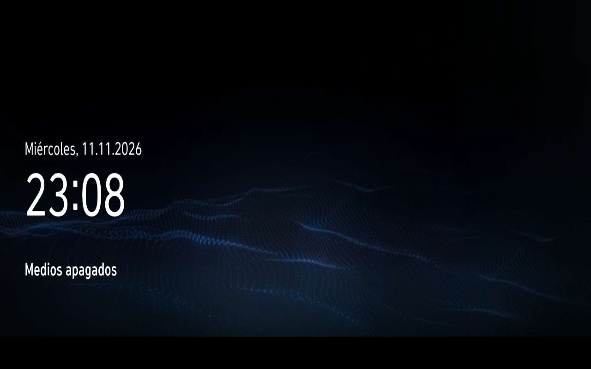
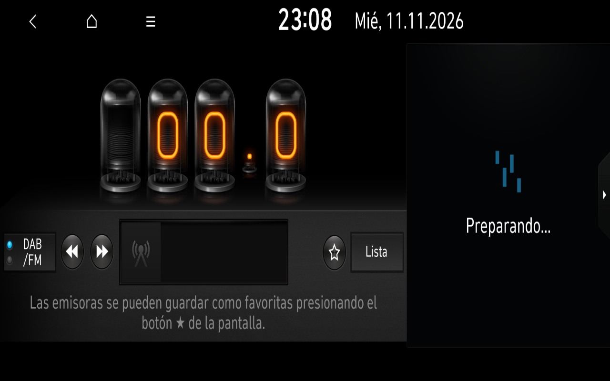
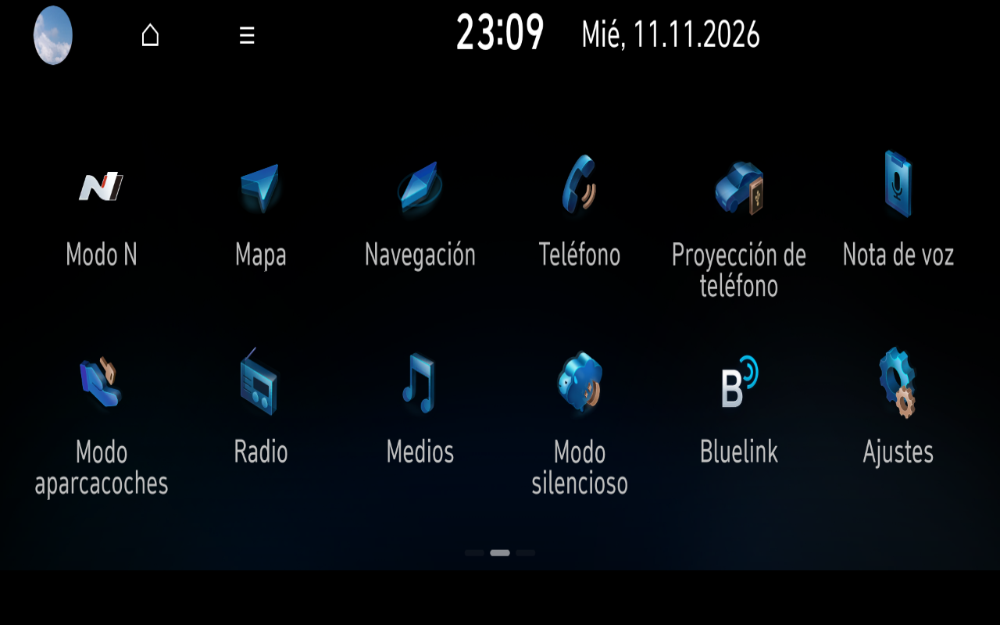

# Home–Radio–Home stability checkpoint

**Date:** 12 November 2026  
**Scope:** original applications inside the complete offline development platform; disposable overlay; not promoted into the frozen Windows product.

## Runtime verified

The integrated system reached the original Home, launched the original European Radio through `ApplicationManager`/`AppLauncher`, returned to Home and remained there through the bounded stability hold. The guest then shut down cleanly.

- Home, Radio, Weston, `ApplicationManager`, `TimeManager` and `NotificationManager` retained their process identities during the hold.
- Radio was stopped once by the original route, did not respawn and produced no observed core or `SIGSEGV`.
- The final Home framebuffer remained present after the return from Radio.
- No vehicle network, tuner, Bluetooth device, GPS receiver, cellular service or synthetic sensor values were supplied.

This checkpoint validates lifecycle stability for this route. It does **not** add a newly working application and does not establish RF reception or audio output.

## Timing limitation

The latest control requested a 180-second host hold, but independent sampling found a discrepancy between host `MONOTONIC`, `RAW`, `REALTIME` and guest uptime progression. The run is therefore retained as a stability result, not promoted as a performance baseline or a physical-duration comparison with earlier TCG runs.

No system clock or NTP setting was changed. A future isolated measurement can resolve the timing issue without altering OEM software.

## Reviewed screenshots

The following screenshots come from an earlier completed run of the same integrated Home–Radio–Home route. They were selected because they show distinct useful states and contain no paths, logs or personal data.

| Original Home / media off | Original Radio, no tuner | Original application menu after return |
| :---: | :---: | :---: |
|  |  |  |

The Radio side panel still shows **Preparing…** and the guest has no RF tuner. The application-menu screenshot contains an incomplete clock glyph at the top; it is retained as an honest record of the visible frame, not presented as a corrected final UI.

## Publication boundary

Only this sanitised summary and three owner-reviewed framebuffer captures are public. Private run directories, logs, overlays, firmware, binaries, QML, textures and captured exchanges remain outside the repository. Hyundai GUI visuals and trademarks remain the property of their owners and are not relicensed under this repository's MIT license.
