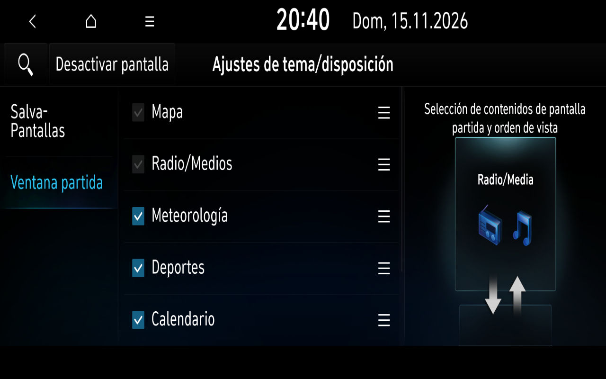
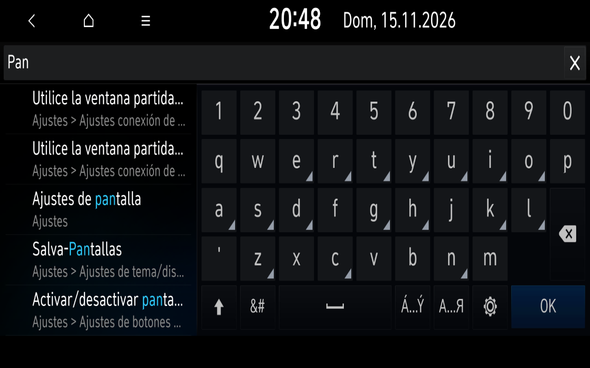
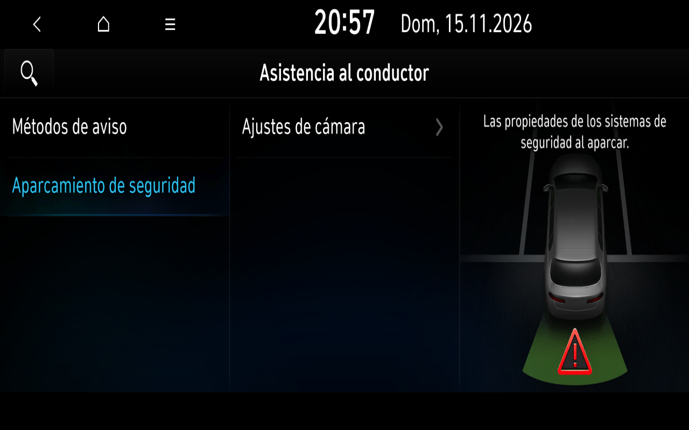
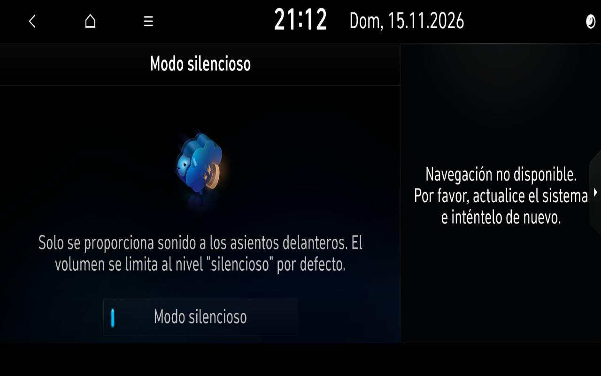
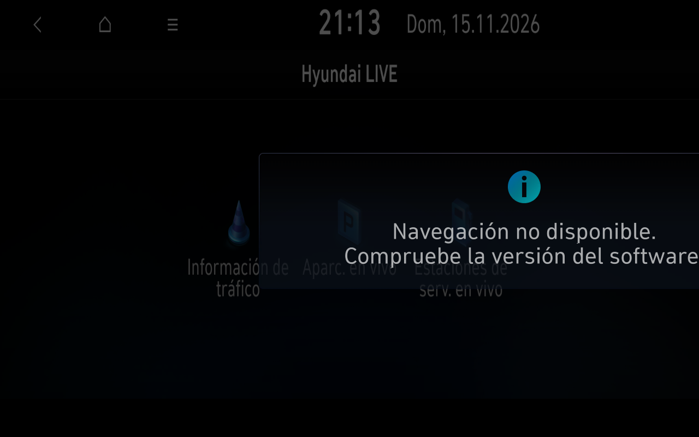
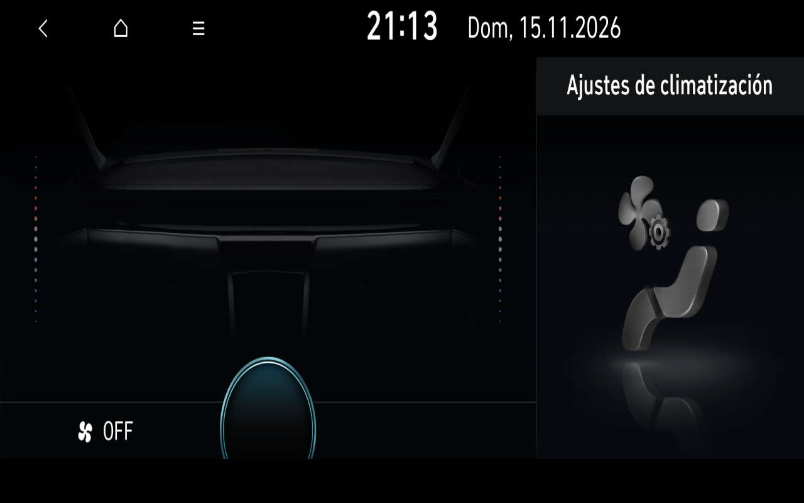
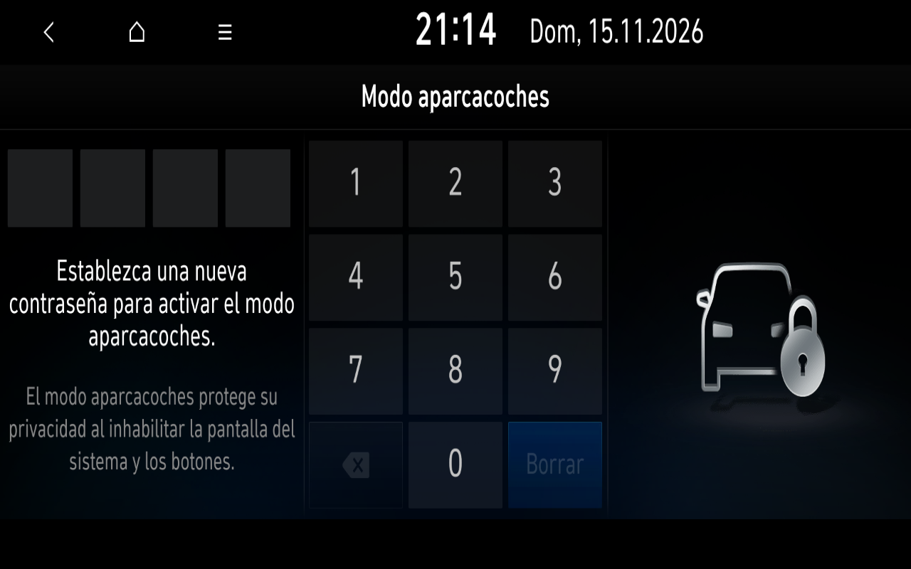

# Functional coverage expansion

**Date:** 15 November 2026
**Scope:** original applications running in disposable, offline KVM development overlays. These results are not promoted into the frozen Windows launcher.

## Runtime-verified results

The laboratory now uses application IDs, launch reasons and process ownership observed in the owner's private vehicle logs. The private evidence maps 91 logical application IDs to 18 original processes. No raw vehicle logs, UART payloads, firmware, binaries or QML are published.

The following original views completed their bounded development checks:

| View | Verified result | Limit |
| --- | --- | --- |
| Theme/layout (480) | Opened the Spanish Theme/Layout page, navigated to Split screen and returned to Home | Preferences were not changed |
| Keyboard/search (460) | Entered and deleted text, filtered original Settings results and returned to Home | Search indexes only installed local menus |
| Vehicle settings (61) | Opened Driver assistance and Parking safety, navigated internally and returned to Home | A private, deterministic ignition-on fixture was required; no other vehicle signals were supplied |
| Quiet mode (368) | Opened, enabled and disabled the original toggle, then returned to Home | No physical audio or occupant behaviour was tested |
| Hyundai LIVE (450) | Opened the service menu and displayed the original Navigation unavailable warning | No network, navigation database or Hyundai service was available |
| Climate (13) | Opened the original climate view in its native OFF/no-data state and returned to Home | No CAN or physical climate data; the tested control produced no visible change |

Every accepted route used the original application process, reached the expected manager/drawing state, retained the sampled platform identities, returned to Home, produced no observed core and ended with a clean S5 shutdown.

## Partial results

- **Profile (362):** the original Guest profile page opens. Selecting Change user reaches the original Driver 1 / Driver 2 / Guest confirmation screen, but that flow has not yet completed a stable return to Home. No driver account was created.
- **Valet (29):** the original four-digit PIN screen opens and returns to Home. Internal keypad input remains unverified because the opening window changed geometry during the bounded click sequence. No PIN was completed.
- **Engineering Mode (301):** the real on-demand launch contract was identified and the original process registered with the manager. The application then failed to create its requested EGL context and produced a private diagnostic core before drawing any UI. No Engineering Mode control was pressed, and this is not counted as functional.

## Reviewed screenshots

| Theme / split-screen settings | Keyboard search |
| :---: | :---: |
|  |  |

| Vehicle settings / parking safety | Quiet mode enabled |
| :---: | :---: |
|  |  |

| Hyundai LIVE offline warning | Climate without vehicle data | Valet PIN screen |
| :---: | :---: | :---: |
|  |  |  |

## Publication boundary

This report publishes only a sanitised summary and owner-approved framebuffer captures. Private logs, run directories, application binaries, OEM resources, captured vehicle exchanges, overlays and core files remain outside the repository. Visible Hyundai GUI material and trademarks remain the property of their owners and are not relicensed under this repository's MIT license.
