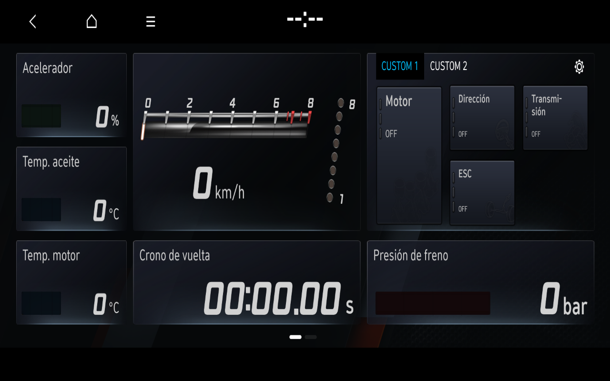
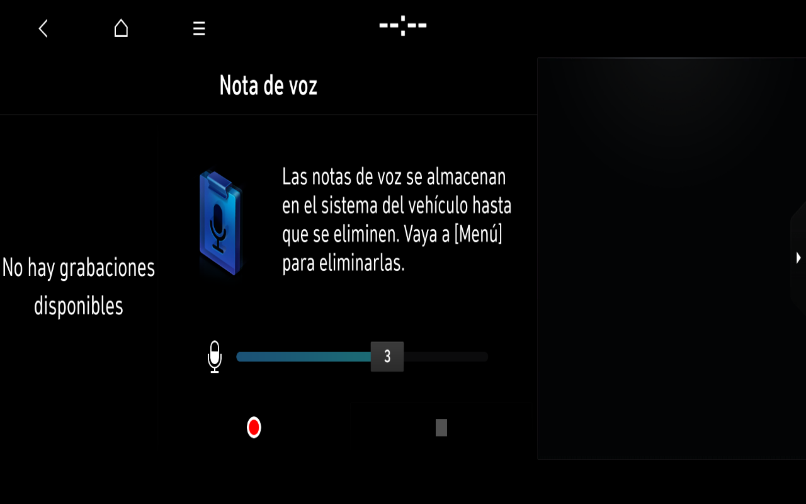

Desarrollo: [General recuperado y Sonido original en español](../PROGRESS-2026-11-08-SETTINGS-ORDER-SOUND.md). El control de referencia completa General → Español → Home. Sonido muestra contenido y recursos originales a tamaño correcto; integración de proveedores, páginas restantes y latencia siguen pendientes. No se modifica el lanzador aceptado.

Desarrollo: [reloj OEM visible y trabajo de integración pendiente](../PROGRESS-2026-11-08-ORIGINAL-CLOCK.md). TimeManager original ya proporciona fecha y hora de la VM a Home. Madrid/DST y una regresión gráfica de Ajustes siguen en investigación; el perfil aceptado se conserva.

Desarrollo: [Conexión de teléfono OEM en español, Información y retorno Home](../PROGRESS-2026-11-08-BLUETOOTH-SETTINGS.md). Geometría y ciclo con ratón comprobados en desarrollo; ilustración original recuperada por CPU. Sin emparejamientos ni datos inventados; el perfil Windows aceptado se conserva.

Desarrollo: [nuevas categorías de Ajustes y decodificación ASTC por CPU](../PROGRESS-2026-11-08-SETTINGS-CATEGORIES-ASTC.md). Tema, botones N, Perfil y Teclado latino originales en español comprobados en desarrollo, con retornos nativos. Nota de voz117 también completó su interfaz vacía y Atrás a Home en desarrollo, sin grabación ni audio inventado. El producto aceptado se conserva; quedan categorías, recursos, servicios y latencia por resolver.

Desarrollo actual: [General original en español y nuevas páginas de Ajustes](../PROGRESS-2026-11-08-SETTINGS-GENERAL-SPANISH.md). Registro D-Bus, Teclado, Pantalla y retornos nativos comprobados en desarrollo; recursos y latencia pendientes. Se conserva el lanzador v1, sin preparar v2.

Desarrollo actual: [Ajustes originales y persistencia OEM](../PROGRESS-2026-11-07-SETTINGS-PERSISTENCE.md). Sonido y Ecualizador visibles en desarrollo separado; integración pendiente. El lanzador v1 se conserva.

**Entrega local verificada, 7 noviembre 2026:** [lanzador Windows e integración del multimedia](../PROGRESS-2026-11-07-WINDOWS-PRODUCT.md). El acceso directo inicia WSL/QEMU con overlay nuevo; Home, N Mode, Radio FM sin sintonizador y Manual originales completan un recorrido español con retornos y ratón real a través de noVNC. Detener apaga limpiamente; reinicio inmediato y exclusión de VM duplicada comprobados. [Uso y código propio](../WINDOWS-LAUNCHER.md) · [Aplicaciones disponibles y límites](../APPLICATIONS-INTEGRATED.md). El ejecutable está instalado en el PC privado del propietario; el repositorio no contiene un emulador autónomo preparado ni firmware.

Un retorno negro en otra secuencia y un reinicio OEM de Radio antes de Home listo permanecen documentados. Ajustes, Medios y Nota de voz no se consideran integrados como aplicaciones navegables. Perfiles anteriores intactos; no se declara completado todo el multimedia.

---

Los hitos inferiores son históricos y pueden corresponder a perfiles diferentes. La disponibilidad actual es la matriz integrada enlazada arriba.

Latest result: [BC3N25MY original N Mode, Spanish artwork and native Home icon cycle](../PROGRESS-2026-11-07-BC3N25-NMODE-RENDER.md). Both pages, two Home returns and subsequent Home navigation are verified without N Mode capability/argv adapters. Original observed artwork is restored through CPU decoding; vehicle functions remain unverified.

Owner software-profile preference: **BC3N25MY**; physical vehicle **i20 N MY23, Spain/Europe**, software updated2025. Native startup comparison and remaining limits: [profile report](../PROGRESS-2026-11-07-BC3N25-SOFTWARE-PROFILE.md). Functional references remain preserved.

Latest verified checkpoint, 7 November 2026: [Original Spanish Voice Memo and native Back/Home cycle](../PROGRESS-2026-11-07-VOICE-MEMO-UI.md). Original Voice Memo117 in AppMediaPlayer now shows its empty-list UI, receives native mouse return and restores aligned navigable Home in three separate instrumented overlays. A measured compositor fit corrects its 1920×720 presentation on 1280×800 output; 35 original CPU-decoded textures restore the observed artwork; timing influence remains unresolved. Recording/playback/audio are untested. Owner target remains BC3N i20 N MY23 Spain/Europe, software updated in 2025; full OEM vehicle identity is still pending. Earlier references below remain preserved.

Original Voice Memo empty-list UI, fitted to the laboratory output with 35 decoded original textures. Recording/playback/audio remain untested; the right assistant pane is empty. [Evidence and limits](../PROGRESS-2026-11-07-VOICE-MEMO-UI.md) · [Screenshot provenance](../images/2026-11-07/README.md).

Latest verified checkpoint, 7 November 2026: [Original N Mode Track, MY23 scope and expanded audit](../PROGRESS-2026-11-07-NMODE-MY23-TEXTURES-AUDIT.md). Owner target is BC3N i20 N **MY23 Spain/Europe**, software updated in 2025; not BC3N25MY. Original nm2/pf0 Track pages, VNC interaction, aligned Home return and further Home navigation are verified in a separate offline profile. Sixty-six further decoded textures have 132 matching base-source hashes and pixel roundtrips; one empty pair is excluded. Full OEM vehicle identity remains unverified (existing CarType fixture 0/LX2). Media provider startup is unblocked in an explicit temporary OEM-library runtime profile; its GUI remains unverified. Thirty-five Launcher / 154 manager metadata entries are inventoried, with unsafe routes excluded. Earlier entries below are historical where superseded. The original Spanish Manual subview now also completes native Back and subsequent Home navigation. Voice Memo117 remains blocked with an empty IVI buffer despite original requestShow; no hardware cause is assumed.

Latest verified checkpoint, 7 November 2026: [Original integrated N Mode UI and application audit](../PROGRESS-2026-11-07-NMODE-APP-AUDIT.md). Original Spanish N Mode500 displayed through the original manager/launcher, accepted VNC interaction and returned to aligned navigable Home. This is a partial legacy UI milestone with explicit local capability configuration,21 decoded original textures and unavailable sensor data; exact BC3N/nm2 fidelity remains pending. The separate stable Home/Radio profile is preserved. A35-entry static inventory and bounded offline application audit distinguish metadata, visible functionality and exclusions.

Latest verified checkpoint, 7 November 2026: [Radio viewport, VNC return and optional Windows export](../PROGRESS-2026-11-07-RADIO-VIEWPORT-EXPORT.md). A new offline overlay verified a fitted original Radio reopen, aligned Home return and further VNC page navigation with the original processes retained. Windows screenshot export failures now remain locally recorded secondary-copy failures. Station List after reopening and slow presentation remain pending; the previous software/stability profile and default launcher are unchanged. No new ten-minute stability test was run.

Earlier verified checkpoint, 7 November 2026: [Spanish original cycle and bounded post-cycle stability](../PROGRESS-2026-11-07-SPANISH-STABILITY.md). Original Confirm→Home→Radio→Home completed, followed by 658.75s of monitoring and five further native Home page changes. All six original process identities were retained; eleven checked Home images match their complete page references. Guest shutdown was clean. A Windows operator launcher has started a separate overlay and remains under validation. This is an offline UI milestone, not a completed emulator or proof of RF/audio/navigation/GPU functionality.

# Hyundai i20 N Infotainment Lab

**Independent, community-driven reverse engineering and offline emulation research.**  
**Status:** experimental. Original Spanish Confirm/Home/Radio/Home and bounded post-cycle Home stability are verified in separate trials. Reopening Radio now fits the laboratory output and returns to aligned, VNC-navigable Home in one new trial. Station List after reopening, presentation latency, the final Windows launcher, audio and remaining applications are still pending. OEM material stays private.

**Latest (6 November):** [Radio artwork, Spanish catalogs and remaining watchdog](../PROGRESS-2026-11-06-RADIO-TEXTURES-SPANISH.md).

**Earlier (6 November):** [Home alignment, animation timing and input validation](../PROGRESS-2026-11-06-HOME-ALIGNMENT.md).

**Previous:** [Home to European Radio and authentic Home return](../PROGRESS-2026-11-01-HOME-TO-EURADIO.md). The current European Home sends appid77/reason38; earlier appid70/reason32 requests belong to other configurations. [Hidden Home diagnosis and input evidence](../PROGRESS-2026-11-01-HIDDEN-HOME.md) explains the preceding callback stalls and measured genuine Ping replies.

## Research progress (1 November 2026; privately observed tests)

| Component | Status |
| --- | --- |
| Isolated QEMU Linux guest and graphics | Running in the private lab |
| Weston + Wayland IVI | Running |
| OEM Qt 5.4.1 `qmlscene` rendering a **minimal laboratory QML scene** | **Verified** via pixel checks, 14 frame callbacks, Wayland `attach` and `commit` |
| OEM `AppHomeScreen` | Original fullscreen Home at **1280 × 730**; navigation **0 → 1 → 0 while original ApplicationManager is running** (run `20261031T163512Z-9562-1`); independent original N Mode request still returns **255** |
| SocketCAN startup dependency | Identified; compatible modules allowed isolated startup to progress without any CAN traffic |
| Original Home navigation | **Page 0 → 1 transition reported** after corrected pointer drag via a separate lab-built IVI controller; corroborated by original QML event and screenshot |
| Original AppLauncher and application transitions | **Original reduced-list AppLauncher starts original ApplicationManager, Home and Standby** with isolated environment/timing workarounds. Genuine Standby Confirm-driven Home return and **interactive Home after return** demonstrated in `20261101T095842Z-17749-1` with experimental 45 s timer extension and compositor foreground repair; **not yet reliable at original timings** |
| Rendering and stability | **Fullscreen** Weston controller fixed old **320 × 365** tiling; multiple OEM processes have coexisted for ten guest minutes. A **lab-only Wayland frame-callback rescue** prevented Home's hidden-surface watchdog in bounded trials; Mesa **llvmpipe on Home only** avoided manager `AppKill` in later bounded foreground transitions. Manager IPC namespace remains isolated; no production-grade integration |
| Private D-Bus services | Original services/routes examined, including Clock `show_window_fg` and real **UserProfileManager**. Synthetic service compatibility is a **future research direction**, not a completed implementation |
| Original MICOM power initialization | Earlier 1 November OEM MICOM + synthetic QEMU-UART `AskSysBootinfo` test produced a **genuine MICOM→manager D-Bus response** and **`power_status=16`**. Later launcher-controlled Home/Standby tests form a **separate experimental profile**; do not assume those runs shared the same MICOM setup |
| Original secondary UI, Settings and Radio | **Standby** renders original Confirm/Language; a one-click, trace-proven original Confirm handler requests return to Home. Original **Settings** is an internal Home QML submenu, navigable back to original Home page1 in separate runs. Original **Radio** icon invokes authentic `appid=70, reason=32` request, AppEURadio77 now launches, registers and shows FM with a labelled synthetic European boot-info input; interactive operation and stable coexistence remain pending. Original EngineerMode only rendered its title in an earlier trial |

**Earlier checkpoint (1 November 2026, owner-supplied status at 10:19 UTC):** **Original AppLauncher, original manager, original Standby and original Home** can run together in a bounded private QEMU test, after preventing inherited double `QT_WAYLAND_SHELL_INTEGRATION=ivi:ivi` selection and selectively lengthening launcher startup timeouts. In `20261101T095204Z-16827-1` and **`20261101T095842Z-17749-1`**, the original Standby Confirm click—not its separate **automatic original 10 s QTimer path**—emitted the **first and only real OEM request `(304,2,12,1,0)`** after a targeted **10→45 s QTimer extension** in a reversible, private preload probe. Manager reached **standby12/drawn Home11**; the initial Home rendering was partial, but a genuine drag subsequently displayed the **original Home second page with all its icons**. An experimental Weston foreground-surface repair is also involved. **Separate** integrated runs showed original **Home Settings submenu → original Home** round-trip. The latest Radio icon test `20261101T101301Z-27925-1` proved original QML and D-Bus request **`(304,70,32,1,0)`**, but **AppEURadio was not running, manager still drew Home11, and the Radio app did not open**. **Do not treat reply 255 alone as success or failure.** This is a controlled lab achievement, **not** a reliable turnkey OEM emulator. See [the detailed 1 November Confirm/AppLauncher/Radio report](../PROGRESS-2026-11-01-HOME-CONFIRM-LAUNCHER-RADIO.md).

**Previous checkpoint (1 November 2026, owner-supplied status at 01:58 UTC):** Original MICOM successfully reached its authentic system D-Bus identity using **a second virtual QEMU UART** (the earlier `/dev/ttyS1` ioctls failed on a missing/invalid UART). In controlled run `20261101T015448Z-28405-1`, a **single synthetic virtual-hardware reply** to original **`AskSysBootinfo`** (response identifier `0x8201` and power byte `2` identified through original executable analysis; all other packet fields synthetic zeros) was processed by the **original MICOM**, which sent a **real D-Bus reply** accepted by original **ApplicationManager** (`reply is VALID`). Manager **`power_status` changed from `1` to `16`**, and its original getter returned 16; original Home rendered fullscreen at 110 seconds. A prior direct `NotifyMonitorPowerEvent(16)` call **did not** change power status. **Not yet demonstrated:** whether the manager's internal **`currentStandbyStatus` changes from 10 to 11** or whether Standby returns to Home. Combined Home+manager+Standby+MICOM test `20261101T015819Z-13437-1` was **in progress at this cutoff**. See [1 November MICOM/power report](../PROGRESS-2026-11-01-MICOM-POWER-STATE.md).

**Previous checkpoint (31 October 2026, owner-supplied status at 16:43 UTC):** genuine OEM **Home navigation 0→1→0** is logged **with ApplicationManager running** in `20261031T163512Z-9562-1`. Original **Standby/Clock** becomes foreground and the Confirm/Language form is visible with **`enableBtn=1`**. An earlier controlled run `20261031T132500Z-6658-1` proved the **original Confirm button's pressed/released/btnClicked signals** (`P=R=C=1`) and delivery of a genuine **appid 2 / reason 12** request. **Manager still rejects return**, retaining **`currentStandbyStatus[10]`**. The direct GoHome event `322` returned **255**; neither it nor re-requesting Standby reason 11 is a valid fix. A separate lab **HMI Wayland callback rescue** and **Mesa llvmpipe on Home only** allowed foreground transitions **without Home watchdog or AppKill** in bounded runs, but are **experimental workarounds**. The last test stopped at its programmed **600s limit (`home-exit=124`)**; its final `home_rendered=false` flag must not be mistaken for proof that Home never rendered or for a successful Home return. **A full interactive Home → Standby → Home cycle is not working yet.** Detailed findings: [31 October foreground/return integration report](../PROGRESS-2026-10-31-HOME-STANDBY-INTEGRATION.md).

Details: [Research status](../STATUS.md) · [Latest: 1 Nov Confirm, AppLauncher, Settings and Radio](../PROGRESS-2026-11-01-HOME-CONFIRM-LAUNCHER-RADIO.md) · [Earlier 1 Nov MICOM and power status](../PROGRESS-2026-11-01-MICOM-POWER-STATE.md) · [31 Oct Home/Standby integration](../PROGRESS-2026-10-31-HOME-STANDBY-INTEGRATION.md) · [Earlier 31 Oct app experiments](../PROGRESS-2026-10-31-OEM-APPS.md) · [Earlier IPC/app trials](../PROGRESS-2026-10-30-IPC-APPS.md) · [Earlier GL/WM investigation](../PROGRESS-2026-10-30-GL-INTEGRATION.md) · [30 October progress log](../PROGRESS-2026-10-30.md) · [29 October progress log](../PROGRESS-2026-10-29.md) · [AI-agent handoff](../AI-HANDOFF.md) · [Roadmap](../ROADMAP.md) · [Architecture notes](../ARCHITECTURE.md)

